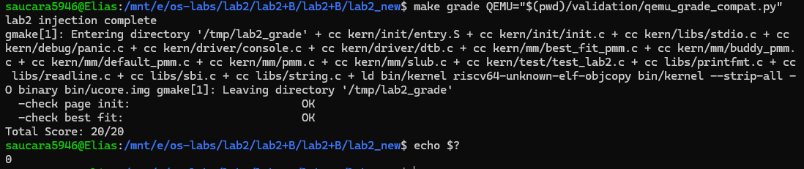
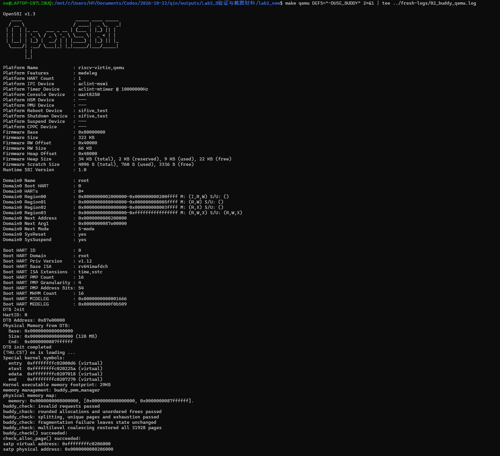
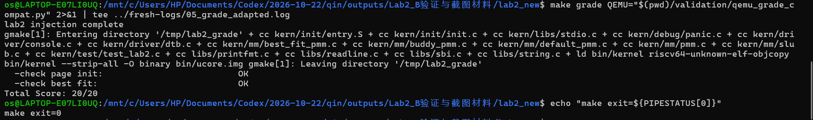

# 操作系统实验报告

## 实验基本信息

| 项目 | 内容 |
|------|------|
| **实验名称** | Lab2：物理内存和页表 |
| **小组成员** | 2412979-单馨淼 2413015-孙若晴 2411356-华轩宁 |
| **完成日期** | __________ |

### 小组分工

练习分工如下：

| 成员 | 负责的练习/模块 |
|------|----------------|
| 2411356-华轩宁 | 物理内存初始化、内存探测 Challenge、First-Fit 分析、Best-Fit 实现与验证 |
| 2413015-孙若晴 | Buddy 与 SLUB 的实现、测试、接入及集成验证 |
| __________ | __________ |


---

## 一、实验目的

1. 理解物理地址、内核虚拟地址、物理页号和页描述符之间的关系。
2. 根据设备树提供的信息初始化物理内存，区分已占用空间与可分配空间。
3. 理解连续物理内存分配中的查找、拆分与合并，实现并验证 Best-Fit。
4. 理解页表和地址翻译，通过 QEMU 调试观察实际执行过程。
5. 使用提示词驱动 AI 实现功能，并通过代码阅读、编译和运行检查验证结果。

---

## 二、实验环境

| 成员 | AI 编程工具 | 底层模型 | 备注 |
|------|------------|---------|------|
| 华轩宁 | Codex | GPT-6.1 Sol | 初始化与 Best-Fit |
| 孙若晴 | Codex | GPT-6.1 Sol | Buddy 与 SLUB |
| __________ | __________ | __________ | __________ |


---

## 三、实验整体逻辑分析

### 3.1 本章节的逻辑主线

本实验围绕物理内存和页表展开：首先确认可用物理内存并建立管理信息，再通过具体分配策略分配和回收空间，另外通过调试理解虚拟地址如何转换为物理地址。内存分配负责管理空间，页表负责地址映射，两者共同支持内存访问。

### 3.2 功能的逐步实现

1. 启动代码建立初始映射，内核解析设备树，获得物理内存范围。
2. 完成物理页描述符初始化，排除 OpenSBI、内核和描述符数组占用的空间，登记可用完整页，为分配器提供基础。
3. 阅读已有 First-Fit，理解空闲链表、分配拆分和释放合并，再实现 Best-Fit 并切换管理器进行验证。
4. Buddy 与 SLUB 的实际实现、接入和验证过程：以 A 登记的可用页为基础，Buddy 按物理对齐建立分阶空闲链表，完成取整分配、拆分与伙伴合并；SLUB 在其上提供 16～2048 字节类别及连续页大对象，完善地址转换，并通过条件编译接入。分别干净构建默认、Buddy 和 Buddy+SLUB 配置，以不重叠、完整读写、失败路径不变、缓存清空及空闲页数恢复验证结果。
5. QEMU 地址翻译调试的实际过程与结果：__________。

初始化与分配器的调用关系为：

```text
kern_entry → kern_init → dtb_init
                      → pmm_init → init_pmm_manager
                                 → page_init → init_memmap
                                 → check_alloc_page
```

---

## 四、实验内容与实现

### 功能模块一：物理内存探测与页描述符初始化

**负责人：** 2411356-华轩宁

#### 模块功能描述

**需要实现/修改的函数：**

```c
static void page_init(void);
```

**功能说明：**

在 `kern/mm/pmm.c` 中实现，供已有 `pmm_init()` 调用。模块从设备树查询物理内存范围，建立页描述信息，保留 OpenSBI、内核与描述符数组占用的空间，并通过当前管理器的 `init_memmap()` 登记剩余完整页。设备树解析和具体分配策略由相应模块提供。

`pages` 是描述符数组的内核虚拟地址；`nbase` 是 DRAM 起点物理页号；`npage` 是管理范围末端的物理页号上界，描述符数量为 `npage - nbase`。空闲页数由管理器单独统计。

**实现思路：**

`page_init()` 通过 `get_memory_base()` 和 `get_memory_size()` 查询内存范围，检查空范围、加法溢出以及是否覆盖内核。设置 `va_pa_offset` 后，取设备树内存终点与 `PHYSICAL_MEMORY_END` 中较小者，并向下按页对齐，得到管理终点 `maxpa`。

描述符数组起点为内核末尾 `end` 向上按页对齐的位置。代码检查数组是否容纳得下，再将每个描述符的标志、引用计数和块长度初始化，并设为保留状态。描述符数组末尾转换成物理地址并向上对齐，形成空闲区起点；只有其后的完整物理页被交给 `init_memmap()`。

关键关系如下：

```text
管理终点 = 向下页对齐(min(设备树内存终点, 框架管理上限))
描述符数量 = npage - nbase
空闲区起点 = 描述符数组物理末尾向上页对齐
登记空闲页数 = (管理终点 - 空闲区起点) / PGSIZE
```

这种安排使内核和管理信息自身不会被当成空闲内存分配。设备树信息无效、描述符无法容纳或没有完整空闲页时，以 `panic()` 终止初始化。

#### 最终提示词

初始化的 spec 根据指导书中的内存布局要求编写，重点约束页号含义、保留区域和完整页边界，防止把内核及管理信息误交给分配器。

```text
请完成 uCore Lab2 的“物理内存探测与页描述符初始化”任务（来自模块一：物理内存初始化功能）。
Prompt：
在 kern/mm/pmm.c 的 lab2 function1 标记处实现 page_init()，
通过实际修改文件代码来完成。
Rely：
需要结合 pmm.c、pmm.h、memlayout.h 和 dtb.h 中的现有定义实现。
Guarantee：
实现 static void page_init(void)，供现有 pmm_init() 调用。
Specification：
保留现有变量语义，特别是 npage 表示物理页号上界，不是空闲页数。
内核和 Page 描述符数组占用的空间不能交给分配器，OpenSBI 占用区域也不能作为空闲内存。
只登记按页对齐后的完整可用页。
内存信息无效或不足以完成初始化时，用 panic() 报错。
完成后简要解释实现思路，并说明如何检查结果；没有实际运行的检查要明确标注。实现思路根据指导书来，最好要有和指导书对应部分的指出。
```

后续实际发送的排障与验证提示词原文：

```text
接下来请继续验证物理内存初始化，先排查 QEMU 只有 OpenSBI
日志、没有内核输出的问题，再运行初始化相关检查。要保存实际执行的命令和关键原始输出！
先确认是否进入 kern_init() 和 page_init()，不要直接假定初始化实现有错。Best-Fit 的未完成部分属于另一任务，启动成功后，运行现有 First-Fit 自检和 test_page_init()

```

#### 实现迭代过程

本功能经过一轮代码生成及后续启动排障和运行验证。

##### 第一次迭代

**遇到的问题、错误信息与原因分析：**

首轮代码通过 RISC-V 编译检查。构建时发现 Best-Fit 骨架缺少定义，临时排除后完成链接。运行时只有 OpenSBI 日志，因此继续排查启动过程。

后续通过日志和 GDB 单步确认两个独立的启动障碍：

| 问题 | 原始现象 | 已确认原因与处理 |
| --- | --- | --- |
| 无法跳到内核 | `Domain0 Next Address : 0x0000000000000000` | 本机旧 loader 参数未给固件提供正确下一跳；改用 `-kernel` 后下一跳为 `0x80200000` |
| 开启分页后无法继续取指 | `Cannot access memory at address 0x80200038` | 原启动页表缺少当前低地址的映射；为根页表第 2 项增加恒等映射后，可继续执行并到达高地址 `kern_init()` |
| 原始骨架构建失败 | `free_list`、`nr_free` 未定义 | 当时 Best-Fit 尚未实现，验证阶段临时排除；后续完成 Best-Fit 后默认构建已通过 |
| 首次 64 MiB 检查未完成 | 8 秒限时结束前未出现 PASS | 将限时延长到 30 秒后完成检查；耗时变化原因待查 |

恒等映射指虚拟地址映射到相同数值的物理地址。写入 `satp` 开启分页不会自动把当前执行地址换成高地址，因此跳转前需要能继续访问低地址的指令。此修复在 `entry.S` 中；启动参数修复在 Makefile 中。


**问题解决策略：**

后续要求 AI 先确认是否进入内核、定位分页前后的执行状态，再进行初始化测试，并保存原始日志。修改 Makefile 启动参数和 `entry.S` 启动页表后，内核成功启动。

**最终结果：**

下表是当时使用 First-Fit 进行的初始化验证：

| 内存配置 | 课程 `test_page_init()` | 额外初始化检查 | 分配释放自检 |
| --- | --- | --- | --- |
| 64 MiB | PASS | PASS | 成功 |
| 128 MiB | PASS | PASS | 成功 |
| 256 MiB | 跳过 | 管理上限专项 PASS | 成功 |

额外检查验证了截断后的管理范围、逐页保留状态、引用计数、准确空闲页数及申请释放后的数量恢复。

```text
[Test 1] Page Init: PASS
[Extra] Page Init: PASS
check_alloc_page() succeeded!
```

内核完成初始化后进入循环，验证脚本在收集输出后结束 QEMU，并根据自检和测试日志判断结果。


**关键改进点总结：**

1. 通过 GDB 单步定位启动入口与分页切换问题。
2. 补充运行验证提示词，保存命令与日志。
3. 完成多种内存容量下的初始化检查。

---

### Challenge：硬件可用物理内存范围的获取方法


操作系统需要根据启动时提供的硬件信息确定内存范围。本工程由启动固件传入设备树地址，已有设备树解析代码取得 memory 节点的范围，内核再排除已占用空间。本次 `page_init()` 使用的就是这一途径。

若移植到其他平台，应通过该平台定义的启动协议、固件提供的内存地图或硬件规定的内存控制器信息取得范围，并区分可用 RAM 与保留区域。直接逐地址读写可能触及设备寄存器或已有数据，因此应优先使用平台提供的内存信息。

---

### 练习：理解 First-Fit 连续物理内存分配算法


#### 已有实现

本任务分析已有的 `kern/mm/default_pmm.c`。空闲块通过按地址排序的双向链表管理；块首页的 `property` 记录连续页数，`nr_free` 记录全部空闲页数量。

| 函数 | 作用 |
| --- | --- |
| `default_init()` | 初始化链表，将空闲页数清零 |
| `default_init_memmap()` | 将一段保留页转为空闲页，并按地址登记块首页 |
| `default_alloc_pages()` | 从链表起点查找，选择第一块足够大的连续空间，必要时拆分 |
| `default_free_pages()` | 按地址归还空闲块，并检查能否与前后相邻块合并 |
| `default_nr_free_pages()` | 返回空闲页总数 |

例如按地址依次存在 10、5、8 页三个空闲块，申请 4 页时，First-Fit 使用第一块 10 页的块，分配后余下 6 页。释放时只有物理地址连续才能合并，链表中位置相邻并不必然表示物理空间连续。

#### 原有 First-Fit 算法是否有进一步改进空间

First-Fit 查找实现简单，但最坏需要遍历全部空闲块，且反复从起点搜索可能让低地址区形成较多碎片。可以考虑从上次位置继续搜索，或采用按大小分组的数据结构减少查找范围，但这会改变状态维护方式或增加管理开销。已有按地址排序的链表方便释放时检查相邻关系，应在查找效率与合并成本之间取舍。


---

### 功能模块二任务二：Best-Fit 连续物理内存分配算法

**负责人：** 2411356-华轩宁

#### 模块功能描述

Best-Fit 从所有足够大的连续空闲块中选择最小的一块，余下空间继续保留为空闲块。

新增实现包括：

```c
static void best_fit_init(void);
static void best_fit_insert(struct Page *base, size_t n);
static void best_fit_init_memmap(struct Page *base, size_t n);
static struct Page *best_fit_alloc_pages(size_t n);
static void best_fit_free_pages(struct Page *base, size_t n);
static size_t best_fit_nr_free_pages(void);
```

其中 `best_fit_insert()` 是内部辅助函数；对外提供 `const struct pmm_manager best_fit_pmm_manager`，其 `.check` 指向已有 `best_fit_check()`。在 `pmm.c` 中将当前管理器切换为它。

**实现思路：**

内部状态沿用 `free_area_t`，空闲块按物理地址递增排序。分配时遍历全部候选块，保留最小的足够大块；遇到完全匹配可立即结束。同样大小的块保留先遇到的低地址块。选中块从链表移除，从低地址端分配申请的页；若有剩余，将余块放回原链表位置。更新块头标记并扣减空闲页数。若总空闲页数足够但没有连续大块，也返回 `NULL`，不改变空闲状态。

登记或释放空闲块时，先按地址插入，再检查前后两侧是否物理连续。合并后移除失效块头，清除其属性。以 10、5、8 页三个空闲块申请 4 页为例，Best-Fit 选 5 页块、留下 1 页；First-Fit 会选前面的 10 页块。

#### 最终提示词

Best-Fit 的 spec 根据算法定义和现有测试接口编写，明确最小合适块选择、拆分合并、失败时状态不变，以及不得修改原有测试等要求。

```text
请完成 uCore Lab2 功能模块二的“Best-Fit 连续物理内存分配”任务，
实际修改工程文件。
工程目录：E:\os-labs\lab2\lab2_new
Prompt：
在 kern/mm/best_fit_pmm.c 的 lab2 function2-2 标记处，
实现 Best-Fit 分配器，并在 pmm.c 中将当前管理器切换为
best_fit_pmm_manager。
Best-Fit 的含义是：申请 n 个连续物理页时，从所有足够大的
空闲块中选择最小的一块；有剩余则保留为空闲块。
释放时，合并物理地址相邻的空闲块。
Rely：
结合 pmm.h、memlayout.h、list.h 的现有定义实现，
参考 default_pmm.c 中的 First-Fit 实现。
物理内存初始化已经完成，当前工程还包含经过验证的启动修复，
请保留这些代码。
Guarantee：
实现完整的 best_fit_pmm_manager，提供现有接口要求的
初始化、空闲区域登记、分配、释放、空闲页计数和自检功能。
Specification：
不修改已有 basic_check() 和 best_fit_check()。
不修改公共接口、Page 结构和宏定义。
无法找到足够大的连续空闲块时返回 NULL，不改变空闲链表和空闲页数量。
分配和释放后，正确维护空闲块标记及空闲页数量。
完成后进行正常构建，不再排除 best_fit_pmm.c，启动内核并运行已有 Best-Fit 自检。
不要修改已有 basic_check() 和 best_fit_check()！
也不要修改公共接口、Page 结构和宏定义。
简要解释实现与指导书任务的对应关系。
保存实际命令、关键输出；出现问题时记录问题描述、原始错误信息和原因分析。未运行的检查明确标注。

```

#### 实现迭代过程


##### 第一次迭代

**遇到的问题：**

实现前完整构建失败，原始骨架报错如下：

```text
error: 'free_list' undeclared (first use in this function)
error: 'nr_free' undeclared (first use in this function)
make: *** [Makefile:116: obj/kern/mm/best_fit_pmm.o] Error 1
```

**原因分析：**

原 Best-Fit 骨架只有测试函数，尚未提供测试引用的空闲链表、空闲页计数及管理器实现。

**问题解决策略：**

补齐内部状态、管理函数和 `best_fit_pmm_manager` 注册结构，并在 `pmm.c` 中切换管理器。完成后使用完整工程进行构建和验证。

**最终结果：**

使用原有 `basic_check()`、`best_fit_check()` 验证实现。关键命令如下：

```sh
make -B -j2
timeout 30s make qemu
```

完整工程构建成功。在独立副本中接入课程检查及额外检查，64、128 MiB 均通过。

```text
memory management: best_fit_pmm_manager
grading: 6 / 6 points
check_alloc_page() succeeded!
[Test 1] Page Init: PASS
[Test 2] Best-Fit: PASS
[Extra] Best-Fit selection/split/fragmentation: PASS
[Extra] Best-Fit two-sided coalescing: PASS
[Extra] Best-Fit multi-region registration: PASS
[Extra] Best-Fit accounting/restoration: PASS
```

额外检查覆盖最小块选择、同大小低地址选择、分裂余块再利用、总空闲量足够但连续空间不足、双侧合并、多段登记及空闲数量恢复。


**关键改进点总结：**

1. 补齐 Best-Fit 管理接口，完成统一接入。
2. 增加最小块选择、碎片和双侧合并检查。
3. 核对分配释放后的空闲页数量。

#### Best-Fit 算法是否有进一步改进空间

当前分配查找和按地址插入的最坏时间复杂度均为 O(B)，B 为空闲块数。按大小建立索引或分组可以减少寻找合适块的开销，但还需维护物理地址邻接关系以支持合并。Best-Fit 也可能留下较多小碎片，优化时应同时考虑查找成本、碎片分布和空间利用率。

---

### 功能模块二任务三：Buddy System 分配算法

**负责人：** 2413015-孙若晴

#### 模块功能描述

在已完成的初始化与 Best-Fit 基础上实现 Buddy 页分配器。Buddy 按 1、2、4、8……页的块管理连续物理内存；申请时将请求页数向上取整为 2 的幂，通过拆分较大空闲块满足请求；释放时只与同阶、空闲且满足伙伴关系的块合并。

新增 `kern/mm/buddy_pmm.c`、`buddy_pmm.h`，在 `pmm.c` 中通过 `USE_BUDDY` 选择管理器；未定义该宏时仍使用 Best-Fit，不改变 A 的 `page_init()`、原评分代码和现有公开接口。

主要回调如下，签名与 `pmm_manager` 一致：

```c
static void buddy_init(void);
static void buddy_init_memmap(struct Page *base, size_t n);
static struct Page *buddy_alloc_pages(size_t n);
static void buddy_free_pages(struct Page *base, size_t n);
static size_t buddy_nr_free_pages(void);
static void buddy_check(void);

extern const struct pmm_manager buddy_pmm_manager;
```

**实现思路：**

1. 按阶维护空闲双向链表，同时记录实际空闲页数。使用已有 `Page`、`page_link` 与地址转换接口，不增加 `struct Page` 字段。
2. 初始化先检查登记区域位于 `npage-nbase` 个描述符之内，且各页原先为保留状态。依据物理页号对齐，将整个区域拆为可表示的块，最后不足大块的尾页继续按更小阶登记，不直接丢弃。
3. 申请 n 页时计算所需阶数，从该阶向上寻找空闲块。找到较大块后逐级拆分，将未使用的一半放回对应空闲链表，返回另一半。空闲页数扣除实际占用的取整页数。
4. 使用当前未占用的私有标志位记录受管页、已分配页和分配首部。空闲块首部的 `property` 保存块页数；已分配首部保存原始请求 n，内部页有已分配标记。
5. 释放必须传原返回首部与原始 n。例如 `alloc_pages(3)` 实际占用 4 页，须用 `free_pages(p, 3)` 归还完整块；不支持部分释放，也不接受虽然同阶但与原请求不同的 n。
6. 伙伴通过物理页号计算：

```text
块页数 = 2^order
伙伴物理页号 = 当前块物理页号 XOR 块页数
```

不能直接对 `Page *` 的数值异或，也不能把链表中相邻的块都视为伙伴。查找前检查描述符边界，合并前检查伙伴为同阶、受管且空闲的块首部，避免越界或跨保留区合并。

对 0、溢出、超过支持范围以及没有合适块的申请返回 NULL，且不改变状态。非法释放通过断言拒绝。各辅助函数及回调为 static，只对外提供管理器对象。

#### 最终提示词

实现提示词：

```text
[PROMPT]
实现 ucore Lab2 Buddy 页分配器。新增 kern/mm/buddy_pmm.c、buddy_pmm.h，修改 pmm.c 的管理器选择。直接修改实际文件，保留 A 的初始化、Best-Fit、原评分代码和现有公开接口。

[RELY]
先读 pmm.h、memlayout.h、pmm.c、list.h 和现有分配器，以真实源码为准。使用 struct Page、pmm_manager、页地址转换和链表接口。PGSIZE=4096，描述符数量为 npage-nbase。

[GUARANTEE]
实现 buddy_init、buddy_init_memmap、buddy_alloc_pages、buddy_free_pages、buddy_nr_free_pages、buddy_check，签名匹配 pmm_manager 回调；定义并声明 buddy_pmm_manager。USE_BUDDY 启用 Buddy，否则保留 Best-Fit。

[SPECIFICATION]
Pre-Condition：管理器初始化后，由 page_init 注册有效可用页。
Post-Condition：支持拆分、分配、回收及伙伴合并，块不重叠，计数准确。
Case 1：初始化按物理对齐拆块，不丢弃尾页。
Case 2：申请 n 页向上取整为 2 的幂，保存分配信息；释放传原始 n，归还完整块，不支持部分释放。
Case 3：0、溢出、超大或无可用块的申请返回 NULL，状态不变。
Requirements：不越界、不合并保留区；辅助函数 static。check 包含真实申请、释放断言。构建默认及 Buddy 配置，报告实际结果。
```

测试提示词：

```text
[PROMPT]
阅读实际 Buddy 实现，完善 kern/mm/buddy_pmm.c 的 buddy_check()，直接编写并运行测试，不改 A 或原评分代码，不放宽断言掩盖错误。

[RELY]
使用 alloc_pages、free_pages、nr_free_pages、page2pa、assert、cprintf；必要时只读检查内部状态。请求按 2 的幂占用，释放传原始请求页数。

[GUARANTEE]
完善 static void buddy_check(void)，由管理器 .check 调用；可增加 static 测试辅助函数。

[SPECIFICATION]
Pre-Condition：USE_BUDDY 启用且可用页注册完成。
Post-Condition：测试资源全部归还，空闲页数、链表和块状态恢复。
Case 1：测试 1、2、4、8 及 3、5 页请求的对齐、不重叠和计数。
Case 2：受控验证拆分、伙伴合并、多层合并及非伙伴不合并。
Case 3：测试零页、超大、耗尽、碎片、初始化尾页及乱序释放。
Requirements：检查目标块变化，不能仅凭任意大块申请成功判断合并；隔离场景完整恢复状态。运行 make clean 后 make qemu DEFS="-DUSE_BUDDY"。输出覆盖与真实结果；失败保留复现，未运行明确说明。
```

记录说明：现有交流中，Buddy 的实现、自检与主机测试在实现阶段一并完成；未单独记录一次按上述测试提示词再次修改 `buddy_check()` 的迭代。下面的结果均以已保存的实际源码和运行日志为依据，不将提示词中的目标直接当作完成证据。

#### 实现迭代过程

**第一次：核对框架并完成实现。**

先读取 `pmm.h`、`memlayout.h`、`pmm.c`、`list.h` 以及已有分配器，确认页大小为 4096 字节、描述符数量为 `npage-nbase`。随后实现按物理对齐登记、按阶拆分、保存原始请求及伙伴合并，并增加条件编译开关。默认与 Buddy 配置均干净构建成功。

**第二步：用实际申请释放及结构不变量检查正确性。**

`buddy_check()` 检查块的物理对齐、各阶链表、块内描述符状态、实际空闲计数以及是否仍有可合并伙伴。先记录初始各阶块数，再申请并乱序释放 1、2、3、5、8 页；其中 3 和 5 分别取整为 4 和 8 页。

随后逐页耗尽空闲区，迫使原有大块拆到最小阶，并通过引用计数标记辅助检查是否重复分配。只释放物理页号为奇数的页、保留其偶数伙伴后，验证即使总空闲量足够也不能申请 2 页块；最后归还全部页，检查空闲页数和各阶块数恢复。

主机补充测试用实际 Buddy 源码与 ucore 头文件运行，覆盖非对齐起点、尾页、多段登记、保留区空洞、随机申请释放及非法释放，并启用 ASan/UBSan。它验证分配算法与描述符状态，不替代 QEMU 中的真实内核启动。

**遇到的问题与处理：**

原始 `make grade` 在本机成功编译评分副本，但串口只有 OpenSBI 输出，显示 `Domain0 Next Address : 0x0000000000000000`，未进入 ucore。用未修改原始包也能复现该评分启动问题，不能据此判断 Buddy 分配失败。

为保留 A 和原评分代码，另提供外部 QEMU 适配器，将评分命令中的 generic loader 参数转换成对应的 `-kernel` 参数；不修改评分脚本、测试断言或 Makefile。默认配置经该外部适配后得到 20/20。Buddy 本身由 `make qemu DEFS="-DUSE_BUDDY"` 和专用自检验证，不能用 Best-Fit 专用评分替代。

本阶段未发现需要另外修复的 Buddy 分配器缺陷，没有降低断言或修改原测试以使其通过。

#### 测试覆盖与最终结果

| 测试范围 | 实际检查 | 结果 |
| --- | --- | --- |
| 基本及非 2 的幂申请 | 对齐、不重叠、原始 n、3→4/5→8 页占用及数量变化 | 通过 |
| 拆分与耗尽 | 逐页分配直到无空闲页，检查重复分配和耗尽后的失败返回 | 通过 |
| 碎片与伙伴约束 | 仅释放奇数物理页，2 页请求失败且状态不变 | 通过 |
| 乱序释放与多级合并 | 所有页归还后，各阶块数及总空闲页数恢复 | 通过 |
| 初始化边界 | 32 种起点×65 种长度，共 2,080 组对齐/尾页组合 | 通过 |
| 多段登记 | 相邻段合并、保留区空洞、最后一个描述符不丢失 | 通过 |
| 随机序列 | 20,000 次混合申请和释放，检查重叠及计数 | 通过 |
| 非法释放 | 错误 n、部分释放、重复释放、保留页、零长度、越界首部 | 6 类均按预期触发断言，返回 73 |
| 主机内存检查 | 有效操作测试启用 ASan/UBSan | 未报告错误 |

关键构建与启动命令：

```sh
make clean
make -j2 DEFS="-DUSE_BUDDY"
make qemu DEFS="-DUSE_BUDDY"
```

Buddy 首次独立版本的实际输出摘录：

```text
memory management: buddy_pmm_manager
buddy_check: invalid requests passed
buddy_check: rounded allocations and unordered frees passed
buddy_check: splitting, unique pages and exhaustion passed
buddy_check: fragmentation failure leaves state unchanged
buddy_check: multilevel coalescing restored all 31928 pages
buddy_check() succeeded!
check_alloc_page() succeeded!
```

主机实际输出摘录：

```text
HOST: 2080 alignment/tail cases passed
HOST: adjacent maps, holes and last descriptor passed
HOST: 20000 randomized operations passed
HOST: all valid-operation tests passed
```

上述 31,928 页对应 Buddy 首次独立构建；加入 SLUB 后内核及静态数据占用发生变化，最终集成版本恢复到 31,926 页。判断是否泄漏应比较同一构建自检前后的页数，而不是比较两个不同版本的绝对数值。原始证据见 [Buddy 启动日志](验证材料/历史验证/buddy-B/buddy_boot.log) 和 [主机测试日志](验证材料/历史验证/buddy-B/host_tests.log)。

---

### Challenge：SLUB 小对象分配算法

**负责人：** 2413015-孙若晴

#### 模块功能描述

在 Buddy 上实现简化的两层内存分配：底层以连续物理页为单位提供空间，上层把页划为小对象槽，向调用者返回可直接读写的内核虚拟地址。它体现对象缓存与页分配分层的思想，没有实现 Linux SLUB 的全部优化。

新增 `kern/mm/slub.c`、`slub.h`，提供：

```c
void slub_init(void);
void *kmalloc(size_t size);
void kfree(void *ptr);
void slub_check(void);
```

修改 `pmm.h` 恢复 `KADDR`，补充 `page2kva`、`kva2page`，并检查物理地址、内核直接映射地址和描述符的上下界。在 `kern/init/init.c` 中，只有启用 `USE_SLUB` 时才在 `pmm_init()` 后初始化并运行自检；该宏必须与 `USE_BUDDY` 同时启用，否则编译报错。

```text
pmm_init()
  → Buddy 初始化、登记可用页及原 Buddy 自检
slub_init()
  → 初始化静态缓存链表，不预占动态页
slub_check()
  → 对象分配、读写、回收与集成检查
```

**小对象分配：**

设置 16、32、64、128、256、512、1024、2048 字节八个 2 的幂容量类别，请求选择不小于 size 的最小类别。例如申请 100 字节进入 128 字节类别。各类别维护活动页链表，页头用位图记录槽的占用；现有页无可用槽时通过 `alloc_pages(1)` 申请新页。

元数据位于页头，不放在用户承诺容量内。RV64 本次构建中，页头按 16 字节对齐后为 96 字节，因此：

```text
每页槽数 = floor((4096 - 96) / 类别容量)
```

例如 128 字节类别每页 31 槽，2048 字节类别每页 1 槽。返回的对象起点和槽间距均保证 16 字节对齐；即使是 2048 字节对象，其容量也不被页头侵占。

**大对象分配：**

大于 2048 字节时直接申请连续页。先检查 size 加页头是否溢出，再计算：

```text
原始申请页数 n = ceil((size + 页头大小) / 4096)
底层实际占用页数 = 不小于 n 的最小 2 的幂
```

页头保存归属页和原始 n，`kfree` 传原始 n 归还 Buddy 完整块。例如 8192 字节用户数据加 96 字节页头需要原始 3 页，Buddy 实际占用 4 页；释放必须完整归还 4 页。

**回收与异常处理：**

小对象释放后清除槽位；该页最后一个对象释放时，先从活动链表移除页头，再立即归还底层页。大对象同样先移除归属记录，再完整释放页块。

`kfree` 只遍历当前活动记录来判断归属，不把任意指针向下取整后直接读取页头；释放页后立即返回，避免再次访问已释放元数据。`kmalloc(0)` 返回 NULL，`kfree(NULL)` 无操作；溢出或底层空间不足时返回 NULL，不留下部分构造记录。错误或重复释放通过断言/panic 拒绝。

实现不递归依赖 kmalloc 保存元数据，不改变 `struct Page` 布局，也不更改 Buddy 的块管理状态。当前为单核简化实现，没有多核锁、每 CPU 缓存和 NUMA 支持。

#### 最终提示词

实现提示词：

```text
[PROMPT]
在已验证 Buddy 上实现简化 SLUB。新增 kern/mm/slub.c、slub.h；修改 pmm.h 的地址转换及 kern/init/init.c 的启动接入。直接修改实际文件，保留 A、Buddy、struct Page 布局及原评分代码。

[RELY]
先读实际 pmm.h、Buddy、init.c、list.h、string.h。使用 alloc_pages、free_pages、页地址转换及现有直接映射。KADDR 当前被注释，使用前需恢复并检查有效范围。

[GUARANTEE]
实现 void slub_init(void)、void *kmalloc(size_t size)、void kfree(void *ptr)、void slub_check(void)。完善 KADDR，添加 page2kva、kva2page。USE_SLUB 下在 pmm_init 后初始化并自检；要求同时启用 USE_BUDDY。

[SPECIFICATION]
Pre-Condition：Buddy 初始化完成，SLUB 首次初始化。
Post-Condition：返回至少可写 size 字节、16 字节对齐且不重叠的虚拟地址。
Case 1：小对象使用 16～2048 字节的 2 的幂容量类别，无槽时申请新页。
Case 2：更大对象申请连续页，保存 kfree 所需的归属及释放信息。
Case 3：kmalloc(0) 返回 NULL，kfree(NULL) 无操作；不足或溢出返回 NULL并回滚。
Case 4：小对象空页立即归还，大对象完整释放底层块。
Requirements：元数据不侵占承诺容量，不递归依赖 kmalloc；转换检查上下界，不访问已释放页。单核实现，初始化不预占动态页；自检含写入、读回和释放断言，报告真实构建结果。
```

测试提示词：

```text
[PROMPT]
阅读实际实现，完善 kern/mm/slub.c 的 slub_check() 并运行集成验证。直接修改实际文件，保留 Buddy 自检和原评分逻辑；发现缺陷保留复现，必要修复单独说明并重跑。

[RELY]
使用 kmalloc、kfree、nr_free_pages、assert、cprintf及内存读写。小对象按尺寸类别分配，大对象走连续页；返回地址至少16字节对齐，空页立即回收。

[GUARANTEE]
完善 void slub_check(void)，可增加 static 测试辅助函数。

[SPECIFICATION]
Pre-Condition：USE_BUDDY、USE_SLUB 启用且初始化完成，无外部存活对象。
Post-Condition：所有测试资源释放，页数恢复，缓存无悬挂引用，后续分配正常。
Case 1：测试零长度、NULL、各尺寸类别边界及 2049、4096、4097 字节。
Case 2：验证对齐、不重叠、完整请求范围的数据读写及存活数据保持。
Case 3：验证跨页、槽复用、空页回收、大对象完整释放和乱序释放。
Case 4：验证内存不足及 (size_t)-1 等溢出请求，失败不影响已有对象。
Requirements：容量计算计入元数据，测试记录有界。切换配置前 make clean，分别运行默认 make grade、make qemu DEFS="-DUSE_BUDDY"、make qemu DEFS="-DUSE_BUDDY -DUSE_SLUB"。输出覆盖表与真实日志；区分编译、运行及断言通过，未执行明确说明。
```

#### 实现迭代过程

**第一次：完成两层分配与启动接入。**

阅读真实 `pmm.h`、Buddy、`init.c`、`list.h` 和 `string.h` 后实现对象层。重点处理了此前被注释的 `KADDR`：页描述符与物理地址都不能直接当作对象指针，必须通过已有直接映射得到可访问的内核虚拟地址，并验证范围。

初次实现的默认、Buddy、Buddy+SLUB 配置均构建并启动成功。此阶段还单独运行了真实 `pmm.h` 转换代码的 256 页往返及页末字节检查、16 类非法转换输入、6 类非法对象释放，并验证只启用 `USE_SLUB` 会因缺少 Buddy 而编译失败。各项负向测试按预期拒绝非法操作，而不是将 panic 计为有效操作成功。

**第二次：根据测试提示词增强 `slub_check()`。**

原自检已有基本读写和释放检查，但还需要明确证明：一个 slab 被回收时其他 slab 数据仍正确、容量计算计入元数据、最终缓存双向链表完全清空，以及清理后还能继续分配。

因此增加七组有编号的测试，用随字节偏移变化的模式填充完整范围，并通过 volatile 字节访问读回。普通对象固定最多 64 条记录，实际最大同时使用 62 条；耗尽测试复用已有 `Page.page_link`，申请循环以初始空闲页数为上限，释放次数精确等于记录数。固定并发用例要求至少 128 个空闲页，本次 Lab 实际满足。

本轮仅修改 `slub.c` 的自检及 static 测试辅助函数。文件哈希及代码前缀比对确认，SLUB 分配/释放逻辑、Buddy 自检、A 的代码与原评分逻辑未变。未发现需要另行修复的分配器缺陷，没有通过放宽断言掩盖问题。

**遇到的问题与解决策略：**

| 需要解决的问题或覆盖缺口 | 处理方式 |
| --- | --- |
| 物理页不能直接作为可写对象地址 | 恢复并完善转换接口，通过内核直接映射访问对象 |
| 页头可能侵占承诺容量 | 页头与 payload 分离，小对象写满整个类别容量；槽数明确扣除页头 |
| 大对象释放可能误传取整页数 | 保存 Buddy 原始 n，测试 8192 字节对应 n=3、实占 4 页的完整释放 |
| 仅检查最终总页数不足以证明及时回收 | 每一类最后释放后立即检查返还页数；跨页场景保留其他存活对象 |
| 回收后缓存可能留下悬挂链表引用 | 检查各表头 next/prev 均归位，并重复两轮后续申请、读写、释放 |
| 原始评分未进入内核 | 分开保留原始失败日志和外部启动适配后的 20/20 对照，不修改评分逻辑 |

#### 测试覆盖与最终结果

| 编号 | 实际覆盖 | 结果 |
| --- | --- | --- |
| T01 | 零长度、NULL、物理页/虚拟地址及页末地址往返 | PASS |
| T02 | 34 个尺寸边界，含 2049、4096、4097；对齐、范围不重叠、完整读写、存活数据及溢出请求 | PASS |
| T03 | 八类对象最后释放后立即回收空页 | PASS |
| T04 | 计入页头后填满两页共 62 个 128 字节对象；唯一空槽复用、跨页回收、保留数据和再次扩页 | PASS |
| T05 | 7 种大对象的元数据页成本、Buddy 取整、乱序释放及完整页数恢复 | PASS |
| T06 | 耗尽底层页；新类别、满页类别、大对象失败；已有空槽仍可分配，原对象数据不变 | PASS |
| T07 | 缓存双向链表无悬挂引用，清理后再次运行两轮全部类别及大对象分配 | PASS |

完整构建与启动命令：

```sh
make clean
make -j2 DEFS="-DUSE_BUDDY -DUSE_SLUB"
make qemu DEFS="-DUSE_BUDDY -DUSE_SLUB"
```

最终集成版本的实际关键输出：

```text
buddy_check() succeeded!
check_alloc_page() succeeded!
slub_check: begin free=31926 header=96 records=64
[SLUB T01] PASS zero, NULL and page-address round trips
[SLUB T02] PASS boundaries, full data, alignment, non-overlap, overflow
[SLUB T03] PASS immediate empty-page reclaim for all 8 classes
[SLUB T04] PASS cross-page slots, exact reuse, partial slab reclaim, shuffle
[SLUB T05] PASS metadata-aware large-page costs and complete shuffled frees
[SLUB T06] PASS bounded exhaustion, failed new/full/large allocations, live data
[SLUB T07] PASS empty cache links and two rounds of later allocations
slub_check() succeeded! stages=7 restored 31926 free pages
```

自检前后均为 **31,926 页**。补充主机验证使用真实 Buddy 与 SLUB 源码，只适配用户态地址映射；归还的页立即设为 `PROT_NONE`，用于暴露释放后读取。增强自检和 12,000 次随机操作通过，512 页测试池最终完整恢复，ASan/UBSan 未报告错误。主机测试不替代实际 MMU 和高地址映射验证，后者由 QEMU 集成运行及独立转换测试支撑。

```text
HOST: 12000 random SLUB operations passed (0 allocation failures)
HOST: no access to PROT_NONE freed pages; all pages restored
```

编译器额外生成的栈使用记录显示：最大单个测试函数静态栈帧为 1872 字节，`slub_check()` 自身为 208 字节；这些是单函数记录，不代表完整调用链的精确峰值。

最终集成轮未重复执行首次实现阶段的 16 类非法地址转换、6 类非法 kfree 及配置编译负向用例；它们的既有日志单独保留，不混作最终轮的新执行结果。本次未进行多核或真实硬件验证。证据见 [SLUB 最终启动日志](验证材料/历史验证/slub-B-integration/slub_boot.log)、[主机保护页测试](验证材料/历史验证/slub-B-integration/host_runtime.log) 和 [初次负向测试结果](验证材料/历史验证/slub-B-initial/negative_results.json)。

---

### 分支任务：GDB 调试页表查询过程

**负责人：** __________

#### 调试环境与流程

__________

#### 地址翻译调用路径与关键操作

__________

#### TLB 与页表查询的观察及分析

__________

#### 遇到的问题、AI 协作记录及结果

__________


---

## 五、测试与验证

### A 部分测试结果

| 阶段 | 验证范围 | 结果 |
| --- | --- | --- |
| 初始化阶段（First-Fit） | 64、128 MiB | 原课程初始化检查、额外检查及分配释放自检通过 |
| 初始化阶段（First-Fit） | 256 MiB | 管理上限专项检查通过；原课程初始化检查明确跳过 |
| Best-Fit 完成后 | 强制完整默认构建 | 编译、链接、镜像生成成功 |
| Best-Fit 完成后 | `make qemu` | 启动和原有分配释放自检成功 |
| Best-Fit 完成后 | 64、128 MiB | 原自检 6/6、课程初始化检查、管理器检查及四项额外检查通过 |

使用外部启动适配器运行课程评分，初始化与 Best-Fit 均通过，结果为 20/20，退出状态为 0。

**编译及 `make qemu` 实际运行截图：**


**初始化及 Best-Fit 实际测试输出截图：**



### 其他模块及小组最终集成测试

以下为孙若晴负责的 B 部分后续集成记录，验证范围是已有 A 代码、Buddy 与 SLUB，不替代 C 的 GDB 页表调试记录。前文 A 部分“完整 make grade 尚未运行”为其阶段记录，原样保留；本节记录其后实际执行的结果。

每次切换配置前均执行 `make clean`，并分别检查编译、进入内核及断言输出：

| 配置或检查 | 编译 | 运行 | 断言/结果 |
| --- | --- | --- | --- |
| 默认独立构建 | 成功，退出 0 | 不适用 | 不把编译成功等同于自检通过 |
| 原样 `make grade` | 评分副本成功编译、链接 | 固件未跳入 ucore，命令退出 2 | 内核评分断言未执行，脚本报告 0/20 |
| 外部启动适配后的默认评分 | 成功 | 进入默认 Best-Fit 内核 | 原评分逻辑通过，20/20，退出 0 |
| `make qemu DEFS="-DUSE_BUDDY"` | 成功 | 进入内核并完成初始化 | Buddy 原自检与 check_alloc_page 通过 |
| `make qemu DEFS="-DUSE_BUDDY -DUSE_SLUB"` | 成功 | 进入内核并完成初始化 | Buddy 自检保留并通过，SLUB T01～T07 全通过 |
| 主机补充测试 | 成功 | 正常退出 0 | 增强自检及 12,000 次随机操作通过；释放页保护和 ASan/UBSan 未报错 |

实际命令为：

```sh
make clean
make -j2
make grade

make clean
make -j2 DEFS="-DUSE_BUDDY"
make qemu DEFS="-DUSE_BUDDY"

make clean
make -j2 DEFS="-DUSE_BUDDY -DUSE_SLUB"
make qemu DEFS="-DUSE_BUDDY -DUSE_SLUB"
```

QEMU 实验内核完成初始化后进入无限循环，验证程序在 12 秒后停止进程。通过依据是停止前已出现规定成功标记、没有内核 panic/断言失败，不能把限时停止当作进程自然返回 0。

最终集成自检前后空闲页均为 31,926，所有缓存表头的 next/prev 恢复，且清理后两轮再次申请、写读与回收正常。本节无 C 模块的实际调试执行记录，不将 C 的待填内容记为已完成。

**完整 `make grade` 结果与截图：**

以下为此前验证的原始终端输出摘录；2026-10-23 重跑的真实截图、日志及环境说明见本节末补充记录。

原样 `make grade` 的输出：

```text
lab2 injection complete
  -check page init:                          WRONG
   -e !! error: missing '[Test 1] Page Init: PASS'
  -check best fit:                           WRONG
   -e !! error: missing '[Test 2] Best-Fit: PASS'
Total Score: 0/20
make: *** [Makefile:211: grade] Error 1
```

对应串口记录中 `Domain0 Next Address : 0x0000000000000000`，尚未进入内核。

不改评分源码，仅使用外部启动适配器进行对照：

```sh
chmod +x validation/qemu_grade_compat.py
make grade QEMU="$(pwd)/validation/qemu_grade_compat.py"
```

```text
  -check page init:                          OK
  -check best fit:                           OK
Total Score: 20/20
```

该 20/20 是**外部启动适配后的默认配置**结果，不是原样命令通过，也不是 Buddy/SLUB 的专用评分。

#### 2026-10-23：Ubuntu 24.04 重跑及真实截图（孙若晴）

本轮由本人在 Ubuntu 24.04.5 LTS（WSL2）终端执行，使用 RISC-V GCC 13.2.0、QEMU 8.2.2 和 OpenSBI v1.3；环境记录见 [本轮工具版本](验证材料/本轮日志/00_environment.log)。本轮与前文历史环境分别记录，未重复主机随机测试、保护页测试和非法释放负向测试。

| 配置 | 编译/启动证据 | 运行及断言结果 |
| --- | --- | --- |
| Buddy | [编译日志](验证材料/本轮日志/01_buddy_build.log)、[运行日志](验证材料/本轮日志/02_buddy_qemu.log) | Buddy 各项自检和 check_alloc_page 成功，恢复 31,928 页 |
| Buddy+SLUB | [编译日志](验证材料/本轮日志/03_slub_build.log)、[运行日志](验证材料/本轮日志/03_slub_qemu.log) | Buddy 自检保留；SLUB T01～T07 全部 PASS，空闲页 31,926→31,926 |
| 原样默认评分 | [评分日志](验证材料/本轮日志/04_grade_raw.log)、[串口日志](验证材料/本轮日志/04_grade_raw_serial.log) | 成功编译；固件 Next Address 为 0，日志无 ucore 启动与评分 PASS 标记，评分 0/20 |
| 外部启动适配后的默认评分 | [评分日志](验证材料/本轮日志/05_grade_adapted.log) | Page Init 与 Best-Fit 均 OK，20/20；真实终端截图记录 make exit=0 |

Buddy、SLUB 的通过依据是运行时实际自检成功标记与断言；内核初始化完成后继续循环，不将退出 QEMU 的状态当作测试自然返回成功。编译日志显示已链接并生成镜像，本轮未单独记录这两次编译的退出码。原样评分和适配评分均为默认配置，不能把其分数当成 Buddy/SLUB 专用评分。

**Buddy 本轮真实运行截图：**



**Buddy+SLUB 本轮真实运行截图：**


**外部 QEMU 启动适配后的默认评分截图：**



原样 0/20 的完整文本日志与串口证据已保留；本材料尚未收到该次运行的屏幕截图。以上图片均为本轮终端原始截图，没有将历史日志渲染或拼接成运行图片。

### 原始证据

- [初始化验证记录](验证材料/历史验证/page-init-20261022/REPORT.md)
- [初始化 128 MiB 日志](验证材料/历史验证/page-init-20261022/test-128M.log)
- [启动修复 GDB 记录](验证材料/历史验证/page-init-20261022/confirm-boot.log)
- [Best-Fit 验证记录](验证材料/历史验证/best-fit-20261022/REPORT.md)
- [Best-Fit 128 MiB 日志](验证材料/历史验证/best-fit-20261022/test-128M.log)

**B 部分新增证据（孙若晴）：**

- [Buddy 实现与验证记录](验证材料/历史验证/buddy-B/REPORT.md)
- [Buddy 首次 QEMU 启动](验证材料/历史验证/buddy-B/buddy_boot.log)
- [Buddy 2,080 组边界与 20,000 次随机测试](验证材料/历史验证/buddy-B/host_tests.log)
- [Buddy 非法释放结果](验证材料/历史验证/buddy-B/invalid_free_results.json)
- [SLUB 初次实现与验证记录](验证材料/历史验证/slub-B-initial/REPORT.md)
- [SLUB 初次地址转换与非法释放测试](验证材料/历史验证/slub-B-initial/negative_results.json)
- [B 最终集成覆盖与验证记录](验证材料/历史验证/slub-B-integration/REPORT.md)
- [最终 Buddy 启动](验证材料/历史验证/slub-B-integration/buddy_boot.log)
- [最终 Buddy+SLUB 启动](验证材料/历史验证/slub-B-integration/slub_boot.log)
- [最终主机保护页、ASan/UBSan 测试](验证材料/历史验证/slub-B-integration/host_runtime.log)
- [配置切换、命令退出及断言状态](验证材料/历史验证/slub-B-integration/results.json)
- [原样评分失败及固件入口证据](验证材料/历史验证/slub-B-integration/default_grade_raw_serial.log)
- [外部适配评分 20/20 对照](验证材料/历史验证/slub-B-integration/default_grade_compatible.log)
- [RISC-V 工具链及 QEMU 版本](验证材料/历史验证/slub-B-integration/toolchain_versions.log)

以上 verification 链接为既有实际执行记录。2026-10-23 新一轮运行使用 fresh-logs 与 screenshots 保存，已在前节单独列出；各轮执行范围、未执行项目及结果分别记录。

---

## 六、实验总结与收获

### 对操作系统的理解

#### 本实验重要知识点与 OS 原理的对应

| 实验内容 | 对应原理及联系与差异 |
| --- | --- |
| `Page` 数组与保留标记 | 物理页状态管理；描述符记录物理页状态，其自身占用的空间也需要保留 |
| 虚拟地址、物理地址与页号换算 | 地址空间与地址转换；本实验内核映射使用固定偏移，便于在对应映射范围内换算地址 |
| 连续块拆分和合并 | 连续内存分配与外部碎片；申请成功需要存在足够大的连续空闲块 |
| First-Fit 与 Best-Fit | 分配策略的取舍；需要结合查找成本、剩余块大小和实际申请序列分析效果 |
| `pmm_manager` 统一接口 | 机制与策略分离；上层沿用申请释放接口，内部可以切换具体算法 |
| 开启分页时的过渡映射 | 页表与执行地址的关系；分页切换时需要保证当前指令地址具有有效映射 |

其他成员负责内容的知识点：B 部分由孙若晴补充如下；C 部分由其负责人继续补充。

| B 部分实验内容 | 对应原理及联系与差异 |
| --- | --- |
| Buddy 按阶组织空闲块 | 将连续页管理限制为 2 的幂块，便于拆分与伙伴定位；代价是非 2 的幂请求产生内部碎片 |
| 物理页号异或定位伙伴 | 块合并依赖物理对齐、同阶和空闲状态；一般地址相邻关系不等于伙伴关系 |
| SLUB 类别与页内槽 | 在页分配上提供小对象分配，多个对象复用同一页；类别取整和页头又带来容量损耗 |
| 元数据与用户容量分离 | 分配器管理信息本身占用空间，必须从可用容量中扣除，不能覆盖承诺给调用者的字节 |
| 描述符、物理地址与虚拟地址 | 管理状态与可访问数据地址不同，必须在已建立的映射范围内转换并检查边界 |
| 对象生命周期与及时回收 | 对象归属记录要在底层页归还前移除，避免空页回收后仍通过缓存访问其元数据 |
| 不变量与阶段化验证 | 编译、运行和断言通过是不同证据；页数、链表及存活数据应在成功与失败路径中均保持一致 |

本实验中的 SLUB 是单核简化实现，未实现真实内核分配器的每 CPU 缓存、多核同步和 NUMA 策略；Buddy 提供连续物理页，不等于已经实现按需调页、页面置换或进程独立地址空间。

#### 重要但本部分未覆盖的原理

进程独立地址空间、按需调页、页面置换、磁盘交换，以及并发内存管理。

小组其他部分完成后，未覆盖原理的统一补充：__________。

### AI 协作开发的经验

本次使用“生成代码—编译—运行—定位问题—复测”的方式推进。初始化首轮通过编译后，通过日志与 GDB 找到启动参数和过渡映射问题，修复后完成自检。

后续提示词结合实际现象提出排查要求，并要求保存命令和输出。验证时使用原有测试和独立副本中的边界检查，重点检查块选择、拆分、合并及数量恢复。

个人补充的实际收获：__________。

其他成员的 AI 协作经验：
B 部分：
1. **先给出真实依赖和接口，再提出功能目标。** 我采用 PROMPT、RELY、GUARANTEE、SPECIFICATION 的结构，要求先读现有 Page、pmm_manager、链表和地址转换接口，明确保留 A 的代码、原评分逻辑和公开接口，避免生成与工程不兼容的独立实现。
2. **将容易误解的约定写入提示词。** Buddy 特别注明非 2 的幂请求向上取整、释放传原始 n、禁止部分释放；SLUB 特别注明元数据不能侵占请求容量、16 字节对齐、空页立即回收和初始化不能预占动态页。这些约定会直接决定状态记录方式和测试断言。
3. **实现与验证分阶段，补测具体缺口。** SLUB 首次可运行后，我又提出独立测试与集成要求，补齐跨页时存活对象保持、计入元数据的页数变化、缓存双向链表清空以及清理后继续分配。改动范围经比对限定为测试函数及辅助函数，没有为通过测试而改弱断言。
4. **区分真实缺陷、环境问题和未覆盖情况。** 原样 make grade 编译成功却因固件入口问题未进入内核，不能写成分配器断言失败，也不能把适配后的 20/20 写成原命令通过。报告分别保存两种结果，未执行或未重复执行的检查明确说明。
5. **用可复核证据评价 AI 输出。** 比起只看一条“成功”提示，更需要检查非重叠、存活数据、失败路径不变、每次回收计数和最终无悬挂引用。固定测试记录及释放页保护也使测试自身的资源占用和生命周期可检查。个人最大的收获是把“代码看起来合理”转化为一组有边界、可复现的运行约束。
