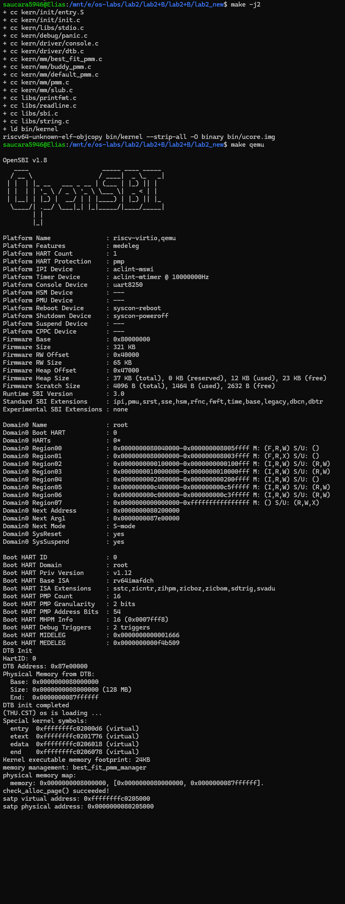
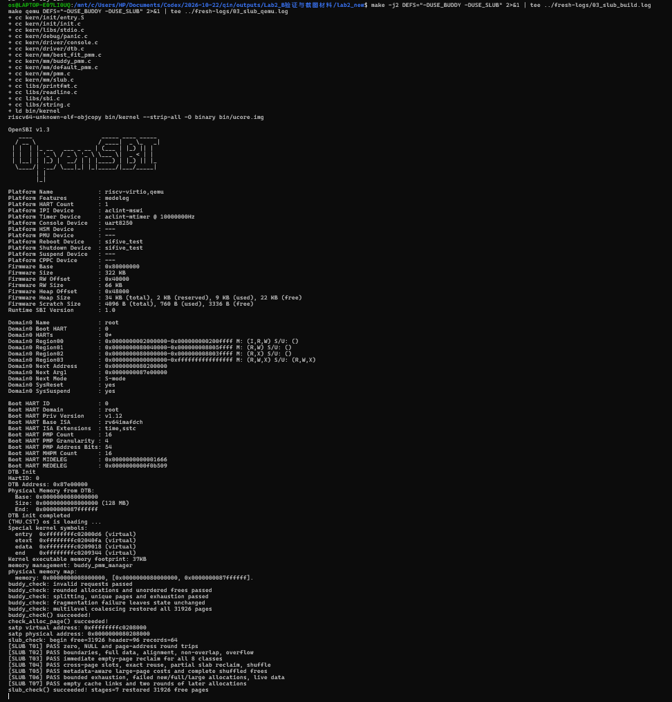

# Lab2 实验报告：物理内存和页表

## 实验基本信息

| 项目 | 内容 |
| --- | --- |
| 实验名称 | Lab2：物理内存和页表 |
| 完成日期 | 2026-10-24 |
| 参考工程 | [Senubis/OSgroup 的 lab2](https://github.com/Senubis/OSgroup/tree/main/lab2) |

### 小组分工与成员信息

| 负责内容 | 姓名 | 学号 |
| --- | --- | --- |
| 物理内存初始化、内存探测 Challenge、First-Fit 分析、Best-Fit 实现与验证 | 华轩宁 | 2411356 |
| Buddy 与 SLUB 的实现、测试及集成验证 | 孙若晴 | 2413015 |
| QEMU 双 GDB 页表调试、运行记录及报告整理 | 单馨淼 | 2412979 |

---

## 一、实验目的

1. 理解物理地址、内核虚拟地址、物理页号和页描述符之间的关系。
2. 根据设备树提供的信息初始化物理内存，区分已占用空间与可分配空间。
3. 理解连续物理内存分配中的查找、拆分与合并，实现并验证 Best-Fit。
4. 理解页表和地址翻译，通过 QEMU 调试观察实际执行过程。
5. 使用提示词驱动 AI 实现功能，并通过代码阅读、编译和运行检查验证结果。

---

## 二、实验环境

| 模块 | AI 编程工具 | 底层模型 |
| --- | --- | --- |
| 初始化与 Best-Fit | Codex | GPT-6.1 Sol |
| Buddy 与 SLUB | Codex | GPT-6.1 Sol |
| 页表调试与报告整理 | Codex | GPT-6 系列 |

本次在 Ubuntu 22.04.5 LTS（WSL 2）中运行参考工程，使用 RISC-V GCC 10.2.0、Make 4.3、GDB 与 GDB Multiarch 12.1。分配器运行采用 QEMU 6.2.0；页表源码调试采用启用调试信息的 QEMU 4.1.1。

报告的初始化、Best-Fit、Buddy 和 SLUB 部分沿用参考工程的实现及验证记录；页表调试和本机运行记录在本次实验中完成。


---

## 三、实验整体逻辑分析

### 3.1 内存管理的整体流程

本实验围绕物理内存和页表展开：首先确认可用物理内存并建立管理信息，再通过具体分配策略分配和回收空间，另外通过调试理解虚拟地址如何转换为物理地址。内存分配负责管理空间，页表负责地址映射，两者共同支持内存访问。

### 3.2 功能的逐步实现

1. 启动代码建立初始映射，内核解析设备树，获得物理内存范围。
2. 完成物理页描述符初始化，排除 OpenSBI、内核和描述符数组占用的空间，登记可用完整页，为分配器提供基础。
3. 阅读已有 First-Fit，理解空闲链表、分配拆分和释放合并，再实现 Best-Fit 并切换管理器进行验证。
4. Buddy 将可用页按物理对齐组织为分阶空闲链表，通过拆分和伙伴合并管理连续页。SLUB 在其上划分 16～2048 字节的对象类别，为更大的对象申请连续页。三个配置分别完成构建与自检。
5. 使用两个 GDB 分别控制实验内核和 QEMU，在存储指令处记录虚拟地址，逐行跟踪页表遍历，再观察 TLB 中的地址映射和宿主机器码。

初始化与分配器的调用关系为：

```text
kern_entry → kern_init → dtb_init
                      → pmm_init → init_pmm_manager
                                 → page_init → init_memmap
                                 → check_alloc_page
```

---

## 四、实验内容与实现

### 功能模块一：物理内存探测与页描述符初始化

#### 模块功能描述

**需要实现/修改的函数：**

```c
static void page_init(void);
```

**功能说明：**

在 `kern/mm/pmm.c` 中实现，供已有 `pmm_init()` 调用。模块从设备树查询物理内存范围，建立页描述信息，保留 OpenSBI、内核与描述符数组占用的空间，并通过当前管理器的 `init_memmap()` 登记剩余完整页。设备树解析和具体分配策略由相应模块提供。

`pages` 是描述符数组的内核虚拟地址；`nbase` 是 DRAM 起点物理页号；`npage` 是管理范围末端的物理页号上界，描述符数量为 `npage - nbase`。空闲页数由管理器单独统计。

**实现思路：**

`page_init()` 通过 `get_memory_base()` 和 `get_memory_size()` 查询内存范围，检查空范围、加法溢出以及是否覆盖内核。设置 `va_pa_offset` 后，取设备树内存终点与 `PHYSICAL_MEMORY_END` 中较小者，并向下按页对齐，得到管理终点 `maxpa`。

描述符数组起点为内核末尾 `end` 向上按页对齐的位置。代码检查数组是否容纳得下，再将每个描述符的标志、引用计数和块长度初始化，并设为保留状态。描述符数组末尾转换成物理地址并向上对齐，形成空闲区起点；只有其后的完整物理页被交给 `init_memmap()`。

关键关系如下：

```text
管理终点 = 向下页对齐(min(设备树内存终点, 框架管理上限))
描述符数量 = npage - nbase
空闲区起点 = 描述符数组物理末尾向上页对齐
登记空闲页数 = (管理终点 - 空闲区起点) / PGSIZE
```

保留区覆盖内核与页描述符数组，空闲区从描述符数组之后开始。设备树信息无效、描述符空间不足或完整空闲页数为零时，`panic()` 终止初始化。

#### 提示词与 spec

初始化的 spec 来自指导书中的内存布局要求，明确了页号含义、保留区域和完整页边界。提示词节选如下：

```text
请完成 uCore Lab2 的“物理内存探测与页描述符初始化”任务（来自模块一：物理内存初始化功能）。
Prompt：
在 kern/mm/pmm.c 的 lab2 function1 标记处实现 page_init()，
通过实际修改文件代码来完成。
Rely：
需要结合 pmm.c、pmm.h、memlayout.h 和 dtb.h 中的现有定义实现。
Guarantee：
实现 static void page_init(void)，供现有 pmm_init() 调用。
Specification：
保留现有变量语义，特别是 npage 表示物理页号上界，不是空闲页数。
内核和 Page 描述符数组占用的空间不能交给分配器，OpenSBI 占用区域也不能作为空闲内存。
只登记按页对齐后的完整可用页。
内存信息无效或不足以完成初始化时，用 panic() 报错。
完成后简要解释实现思路，并说明如何检查结果。实现思路根据指导书来，最好要有和指导书对应部分的指出。
```

后续排障与验证提示词节选：

```text
接下来请继续验证物理内存初始化，先排查 QEMU 只有 OpenSBI
日志、没有内核输出的问题，再运行初始化相关检查。要保存实际执行的命令和关键原始输出！
先确认是否进入 kern_init() 和 page_init()，启动成功后，运行现有 First-Fit 自检和 test_page_init()

```

#### 实现迭代过程

##### 第一次迭代

**遇到的问题、错误信息与原因分析：**

首轮代码通过 RISC-V 编译检查。构建时发现 Best-Fit 骨架缺少定义，临时排除后完成链接。运行时只有 OpenSBI 日志，因此继续排查启动过程。

后续通过日志和 GDB 单步确认两个独立的启动障碍：

| 问题 | 原始现象 | 已确认原因与处理 |
| --- | --- | --- |
| 无法跳到内核 | `Domain0 Next Address : 0x0000000000000000` | 本机旧 loader 参数未给固件提供正确下一跳；改用 `-kernel` 后下一跳为 `0x80200000` |
| 开启分页后无法继续取指 | `Cannot access memory at address 0x80200038` | 原启动页表缺少当前低地址的映射；为根页表第 2 项增加恒等映射后，可继续执行并到达高地址 `kern_init()` |
| 原始骨架构建失败 | `free_list`、`nr_free` 未定义 | 当时 Best-Fit 尚未实现，验证阶段临时排除；后续完成 Best-Fit 后默认构建已通过 |
| 首次 64 MiB 检查未完成 | 8 秒限时结束前未出现 PASS | 将限时延长到 30 秒后完成检查 |

恒等映射指虚拟地址映射到相同数值的物理地址。写入 `satp` 后，处理器继续从当前低地址取指，直到执行跳转指令进入内核高地址。此修复在 `entry.S` 中；启动参数修复在 Makefile 中。


**问题解决策略：**

后续要求 AI 先确认是否进入内核、定位分页前后的执行状态，再进行初始化测试，并保存原始日志。修改 Makefile 启动参数和 `entry.S` 启动页表后，内核成功启动。

**最终结果：**

下表是当时使用 First-Fit 进行的初始化验证：

| 内存配置 | 课程 `test_page_init()` | 额外初始化检查 | 分配释放自检 |
| --- | --- | --- | --- |
| 64 MiB | PASS | PASS | 成功 |
| 128 MiB | PASS | PASS | 成功 |
| 256 MiB | 跳过 | 管理上限专项 PASS | 成功 |

额外检查验证了截断后的管理范围、逐页保留状态、引用计数、准确空闲页数及申请释放后的数量恢复。

```text
[Test 1] Page Init: PASS
[Extra] Page Init: PASS
check_alloc_page() succeeded!
```

内核完成初始化后进入循环，验证脚本收集自检输出后结束 QEMU。


---

### Challenge：硬件可用物理内存范围的获取方法


操作系统需要根据启动时提供的硬件信息确定内存范围。本工程由启动固件传入设备树地址，已有设备树解析代码取得 memory 节点的范围，内核再排除已占用空间。本次 `page_init()` 使用的就是这一途径。

当启动环境没有直接给出内存范围时，可以先查询平台的启动协议和固件内存地图；固定硬件平台还可读取内存控制器的配置。取得各段的起点、长度和用途后，内核把 RAM 中可用的部分登记为空闲页。设备寄存器属于 MMIO 地址，按普通 RAM 扫描会产生设备操作，因此内存探测需要依据平台定义的地址布局。

---

### 练习：理解 First-Fit 连续物理内存分配算法


#### 已有实现

本任务分析已有的 `kern/mm/default_pmm.c`。空闲块通过按地址排序的双向链表管理；块首页的 `property` 记录连续页数，`nr_free` 记录全部空闲页数量。

| 函数 | 作用 |
| --- | --- |
| `default_init()` | 初始化链表，将空闲页数清零 |
| `default_init_memmap()` | 将一段保留页转为空闲页，并按地址登记块首页 |
| `default_alloc_pages()` | 从链表起点查找，选择第一块足够大的连续空间，必要时拆分 |
| `default_free_pages()` | 按地址归还空闲块，并检查能否与前后相邻块合并 |
| `default_nr_free_pages()` | 返回空闲页总数 |

例如按地址依次存在 10、5、8 页三个空闲块，申请 4 页时，First-Fit 使用第一块 10 页的块，分配后余下 6 页。释放时通过块起点和长度计算末端地址，再与相邻块起点比较，确定合并范围。

#### 原有 First-Fit 算法是否有进一步改进空间

First-Fit 的最坏查找开销与空闲块数成正比。反复从链表起点分配会集中拆分低地址块。将上次查找位置保存为游标，可以从该位置继续搜索，分散查找与拆分操作；释放或合并游标所在块时，需要同时更新游标。另一项改进是按块大小建立分组索引，先定位能容纳请求的组，再在组内选择空闲块。分组索引需要随拆分和合并同步更新，原有地址链表则继续承担邻接块定位。


---

### 功能模块二任务二：Best-Fit 连续物理内存分配算法

#### 模块功能描述

Best-Fit 从所有足够大的连续空闲块中选择最小的一块，余下空间继续保留为空闲块。

新增实现包括：

```c
static void best_fit_init(void);
static void best_fit_insert(struct Page *base, size_t n);
static void best_fit_init_memmap(struct Page *base, size_t n);
static struct Page *best_fit_alloc_pages(size_t n);
static void best_fit_free_pages(struct Page *base, size_t n);
static size_t best_fit_nr_free_pages(void);
```

其中 `best_fit_insert()` 是内部辅助函数；对外提供 `const struct pmm_manager best_fit_pmm_manager`，其 `.check` 指向已有 `best_fit_check()`。在 `pmm.c` 中将当前管理器切换为它。

**实现思路：**

内部状态沿用 `free_area_t`，空闲块按物理地址递增排序。分配时遍历全部候选块，保留最小的足够大块；遇到完全匹配可立即结束。同样大小的块保留先遇到的低地址块。选中块从链表移除，从低地址端分配申请的页；若有剩余，将余块放回原链表位置。更新块头标记并扣减空闲页数。若总空闲页数足够但没有连续大块，也返回 `NULL`，不改变空闲状态。

登记或释放空闲块时，先按地址插入，再检查前后两侧是否物理连续。合并后移除失效块头，清除其属性。以 10、5、8 页三个空闲块申请 4 页为例，Best-Fit 选 5 页块、留下 1 页；First-Fit 会选前面的 10 页块。

#### 提示词与 spec

Best-Fit 的 spec 根据算法定义和现有测试接口编写，规定最小合适块的选择方法、拆分和合并过程，以及申请失败时保留空闲状态。提示词节选如下：

```text
请完成 uCore Lab2 功能模块二的“Best-Fit 连续物理内存分配”任务，
实际修改工程文件。
工程目录：E:\os-labs\lab2\lab2_new
Prompt：
在 kern/mm/best_fit_pmm.c 的 lab2 function2-2 标记处，
实现 Best-Fit 分配器，并在 pmm.c 中将当前管理器切换为
best_fit_pmm_manager。
Best-Fit 的含义是：申请 n 个连续物理页时，从所有足够大的
空闲块中选择最小的一块；有剩余则保留为空闲块。
释放时，合并物理地址相邻的空闲块。
Rely：
结合 pmm.h、memlayout.h、list.h 的现有定义实现，
参考 default_pmm.c 中的 First-Fit 实现。
物理内存初始化已经完成，当前工程还包含经过验证的启动修复，
请保留这些代码。
Guarantee：
实现完整的 best_fit_pmm_manager，提供现有接口要求的
初始化、空闲区域登记、分配、释放、空闲页计数和自检功能。
Specification：
不修改已有 basic_check() 和 best_fit_check()。
不修改公共接口、Page 结构和宏定义。
无法找到足够大的连续空闲块时返回 NULL，不改变空闲链表和空闲页数量。
分配和释放后，正确维护空闲块标记及空闲页数量。
完成后进行正常构建，不再排除 best_fit_pmm.c，启动内核并运行已有 Best-Fit 自检。
简要解释实现与指导书任务的对应关系。
保存实际命令、关键输出；出现问题时记录问题描述、原始错误信息和原因分析。

```

#### 实现迭代过程


##### 第一次迭代

**遇到的问题：**

实现前完整构建失败，原始骨架报错如下：

```text
error: 'free_list' undeclared (first use in this function)
error: 'nr_free' undeclared (first use in this function)
make: *** [Makefile:116: obj/kern/mm/best_fit_pmm.o] Error 1
```

**原因分析：**

原 Best-Fit 骨架只有测试函数，尚未提供测试引用的空闲链表、空闲页计数及管理器实现。

**问题解决策略：**

补齐内部状态、管理函数和 `best_fit_pmm_manager` 注册结构，并在 `pmm.c` 中切换管理器。完成后使用完整工程进行构建和验证。

**最终结果：**

使用原有 `basic_check()`、`best_fit_check()` 验证实现。关键命令如下：

```sh
make -B -j2
timeout 30s make qemu
```

完整工程构建成功。在独立副本中接入课程检查及额外检查，64、128 MiB 均通过。

```text
memory management: best_fit_pmm_manager
grading: 6 / 6 points
check_alloc_page() succeeded!
[Test 1] Page Init: PASS
[Test 2] Best-Fit: PASS
[Extra] Best-Fit selection/split/fragmentation: PASS
[Extra] Best-Fit two-sided coalescing: PASS
[Extra] Best-Fit multi-region registration: PASS
[Extra] Best-Fit accounting/restoration: PASS
```

额外检查覆盖最小块选择、同大小低地址选择、分裂余块再利用、总空闲量足够但连续空间不足、双侧合并、多段登记及空闲数量恢复。


#### Best-Fit 算法是否有进一步改进空间

当前分配查找和按地址插入的最坏时间复杂度均为 O(B)，B 为空闲块数。可增加按块大小排序的平衡树，使最小合适块的查询接近 O(log B)，并保留地址链表处理相邻块合并。每次拆分、释放和合并都要更新这两种索引。Best-Fit 选出的余块通常较小；评估改进效果时，可统计余块大小分布、请求失败次数以及维护索引的开销。

---

### 功能模块二任务三：Buddy System 分配算法

#### 模块功能描述

在已完成的初始化与 Best-Fit 基础上实现 Buddy 页分配器。Buddy 按 1、2、4、8……页的块管理连续物理内存；申请时将请求页数向上取整为 2 的幂，通过拆分较大空闲块满足请求；释放时只与同阶、空闲且满足伙伴关系的块合并。

Buddy 由 `kern/mm/buddy_pmm.c`、`buddy_pmm.h` 提供，在 `pmm.c` 中通过 `USE_BUDDY` 选择管理器。默认配置使用 Best-Fit。两者通过 `pmm_manager` 接收 `page_init()` 登记的可用页。

主要回调如下，签名与 `pmm_manager` 一致：

```c
static void buddy_init(void);
static void buddy_init_memmap(struct Page *base, size_t n);
static struct Page *buddy_alloc_pages(size_t n);
static void buddy_free_pages(struct Page *base, size_t n);
static size_t buddy_nr_free_pages(void);
static void buddy_check(void);

extern const struct pmm_manager buddy_pmm_manager;
```

**实现思路：**

1. 按阶维护空闲双向链表，同时记录实际空闲页数。块状态使用已有 `Page`、`page_link` 与地址转换接口管理。
2. 初始化先检查登记区域位于 `npage-nbase` 个描述符之内，且各页原先为保留状态。依据物理页号对齐，将整个区域拆为可表示的块，最后不足大块的尾页继续按更小阶登记。
3. 申请 n 页时计算所需阶数，从该阶向上寻找空闲块。找到较大块后逐级拆分，将未使用的一半放回对应空闲链表，返回另一半。空闲页数扣除实际占用的取整页数。
4. 使用当前未占用的私有标志位记录受管页、已分配页和分配首部。空闲块首部的 `property` 保存块页数；已分配首部保存原始请求 n，内部页有已分配标记。
5. 释放时传入原返回首部与原始 n。例如 `alloc_pages(3)` 实际占用 4 页，`free_pages(p, 3)` 根据首部记录归还完整块。接口通过原始请求值核对分配记录，部分释放和请求值不符会触发断言。
6. 伙伴通过物理页号计算：

```text
块页数 = 2^order
伙伴物理页号 = 当前块物理页号 XOR 块页数
```

异或计算作用于物理页号。得到伙伴页号后，先转换为描述符并检查范围，再核对同阶、受管、空闲和块首部标记；满足这些条件时合并两个块。

对 0、溢出、超过支持范围以及没有合适块的申请返回 NULL，且不改变状态。非法释放通过断言拒绝。各辅助函数及回调为 static，只对外提供管理器对象。

#### 提示词与 spec

实现提示词节选：

```text
[PROMPT]
实现 ucore Lab2 Buddy 页分配器。新增 kern/mm/buddy_pmm.c、buddy_pmm.h，修改 pmm.c 的管理器选择。直接修改实际文件，保留 A 的初始化、Best-Fit、原评分代码和现有公开接口。

[RELY]
先读 pmm.h、memlayout.h、pmm.c、list.h 和现有分配器。使用 struct Page、pmm_manager、页地址转换和链表接口。PGSIZE=4096，描述符数量为 npage-nbase。

[GUARANTEE]
实现 buddy_init、buddy_init_memmap、buddy_alloc_pages、buddy_free_pages、buddy_nr_free_pages、buddy_check，签名匹配 pmm_manager 回调；定义并声明 buddy_pmm_manager。USE_BUDDY 启用 Buddy，否则保留 Best-Fit。

[SPECIFICATION]
Pre-Condition：管理器初始化后，由 page_init 注册有效可用页。
Post-Condition：支持拆分、分配、回收及伙伴合并，块不重叠，计数准确。
Case 1：初始化按物理对齐拆块，不丢弃尾页。
Case 2：申请 n 页向上取整为 2 的幂，保存分配信息；释放传原始 n，归还完整块，不支持部分释放。
Case 3：0、溢出、超大或无可用块的申请返回 NULL，状态不变。
Requirements：不越界、不合并保留区；辅助函数 static。check 包含申请、释放断言。构建默认及 Buddy 配置，报告运行结果。
```

测试提示词节选：

```text
[PROMPT]
阅读实际 Buddy 实现，完善 kern/mm/buddy_pmm.c 的 buddy_check()，直接编写并运行测试，不改 A 或原评分代码。

[RELY]
使用 alloc_pages、free_pages、nr_free_pages、page2pa、assert、cprintf；必要时只读检查内部状态。请求按 2 的幂占用，释放传原始请求页数。

[GUARANTEE]
完善 static void buddy_check(void)，由管理器 .check 调用；可增加 static 测试辅助函数。

[SPECIFICATION]
Pre-Condition：USE_BUDDY 启用且可用页注册完成。
Post-Condition：测试资源全部归还，空闲页数、链表和块状态恢复。
Case 1：测试 1、2、4、8 及 3、5 页请求的对齐、不重叠和计数。
Case 2：受控验证拆分、伙伴合并、多层合并及非伙伴不合并。
Case 3：测试零页、超大、耗尽、碎片、初始化尾页及乱序释放。
Requirements：检查目标块变化；隔离场景完整恢复状态。运行 make clean 后 make qemu DEFS="-DUSE_BUDDY"。输出测试覆盖与运行结果，记录失败用例的复现步骤。
```

Buddy 的实现、自检与主机测试在同一实现阶段完成。

#### 实现迭代过程

**第一次：核对框架并完成实现。**

先读取 `pmm.h`、`memlayout.h`、`pmm.c`、`list.h` 以及已有分配器，确认页大小为 4096 字节、描述符数量为 `npage-nbase`。随后实现按物理对齐登记、按阶拆分、保存原始请求及伙伴合并，并增加条件编译开关。默认与 Buddy 配置均干净构建成功。

**第二步：用实际申请释放及结构不变量检查正确性。**

`buddy_check()` 检查块的物理对齐、各阶链表、块内描述符状态、实际空闲计数以及是否仍有可合并伙伴。先记录初始各阶块数，再申请并乱序释放 1、2、3、5、8 页；其中 3 和 5 分别取整为 4 和 8 页。

随后逐页耗尽空闲区，迫使原有大块拆到最小阶，并通过引用计数标记辅助检查是否重复分配。只释放物理页号为奇数的页、保留其偶数伙伴后，验证即使总空闲量足够也不能申请 2 页块；最后归还全部页，检查空闲页数和各阶块数恢复。

主机补充测试使用 Buddy 源码与 ucore 头文件，覆盖非对齐起点、尾页、多段登记、保留区空洞、随机申请释放及非法释放，并启用 ASan/UBSan 检查内存访问。

**遇到的问题与处理：**

原始 `make grade` 编译评分副本后，串口停留在 OpenSBI，显示 `Domain0 Next Address : 0x0000000000000000`。固件的下一跳地址为零，ucore 启动过程因此中断。

外部 QEMU 适配器将评分命令中的 generic loader 参数转换为 `-kernel` 参数，使固件跳转到内核入口。默认配置经适配后得到 20/20。Buddy 通过 `make qemu DEFS="-DUSE_BUDDY"` 启动并完成自身的分配与回收自检。

#### 测试覆盖与最终结果

| 测试范围 | 实际检查 | 结果 |
| --- | --- | --- |
| 基本及非 2 的幂申请 | 对齐、不重叠、原始 n、3→4/5→8 页占用及数量变化 | 通过 |
| 拆分与耗尽 | 逐页分配直到无空闲页，检查重复分配和耗尽后的失败返回 | 通过 |
| 碎片与伙伴约束 | 仅释放奇数物理页，2 页请求失败且状态不变 | 通过 |
| 乱序释放与多级合并 | 所有页归还后，各阶块数及总空闲页数恢复 | 通过 |
| 初始化边界 | 32 种起点×65 种长度，共 2,080 组对齐/尾页组合 | 通过 |
| 多段登记 | 相邻段合并、保留区空洞、最后一个描述符不丢失 | 通过 |
| 随机序列 | 20,000 次混合申请和释放，检查重叠及计数 | 通过 |
| 非法释放 | 错误 n、部分释放、重复释放、保留页、零长度、越界首部 | 6 类均按预期触发断言，返回 73 |
| 主机内存检查 | 有效操作测试启用 ASan/UBSan | 未报告错误 |

关键构建与启动命令：

```sh
make clean
make -j2 DEFS="-DUSE_BUDDY"
make qemu DEFS="-DUSE_BUDDY"
```

Buddy 首次独立版本的实际输出摘录：

```text
memory management: buddy_pmm_manager
buddy_check: invalid requests passed
buddy_check: rounded allocations and unordered frees passed
buddy_check: splitting, unique pages and exhaustion passed
buddy_check: fragmentation failure leaves state unchanged
buddy_check: multilevel coalescing restored all 31928 pages
buddy_check() succeeded!
check_alloc_page() succeeded!
```

主机实际输出摘录：

```text
HOST: 2080 alignment/tail cases passed
HOST: adjacent maps, holes and last descriptor passed
HOST: 20000 randomized operations passed
HOST: all valid-operation tests passed
```

Buddy 首次独立构建的空闲页数为 31,928。加入 SLUB 后，内核与静态数据的占用增加，集成版本的空闲页数为 31,926；自检结束时恢复到该版本的初始页数。运行记录见 [Buddy 启动日志](验证材料/历史验证/buddy-B/buddy_boot.log) 和 [主机测试日志](验证材料/历史验证/buddy-B/host_tests.log)。

---

### Challenge：SLUB 小对象分配算法

#### 模块功能描述

在 Buddy 上实现简化的两层内存分配：底层以连续物理页为单位提供空间，上层把页划为小对象槽，向调用者返回可直接读写的内核虚拟地址。对象缓存利用页分配器提供的空间，负责管理页内槽位和对象归属。

新增 `kern/mm/slub.c`、`slub.h`，提供：

```c
void slub_init(void);
void *kmalloc(size_t size);
void kfree(void *ptr);
void slub_check(void);
```

修改 `pmm.h` 恢复 `KADDR`，补充 `page2kva`、`kva2page`，并检查物理地址、内核直接映射地址和描述符的上下界。在 `kern/init/init.c` 中，只有启用 `USE_SLUB` 时才在 `pmm_init()` 后初始化并运行自检；该宏必须与 `USE_BUDDY` 同时启用，否则编译报错。

```text
pmm_init()
  → Buddy 初始化、登记可用页及原 Buddy 自检
slub_init()
  → 初始化静态缓存链表，不预占动态页
slub_check()
  → 对象分配、读写、回收与集成检查
```

**小对象分配：**

设置 16、32、64、128、256、512、1024、2048 字节八个 2 的幂容量类别，请求选择不小于 size 的最小类别。例如申请 100 字节进入 128 字节类别。各类别维护活动页链表，页头用位图记录槽的占用；现有页无可用槽时通过 `alloc_pages(1)` 申请新页。

元数据位于页头，对象槽从页头之后开始。RV64 本次构建中，页头按 16 字节对齐后为 96 字节，因此：

```text
每页槽数 = floor((4096 - 96) / 类别容量)
```

例如 128 字节类别每页 31 槽，2048 字节类别每页 1 槽。对象起点和槽间距均按 16 字节对齐，2048 字节类别的槽可容纳完整的 2048 字节数据。

**大对象分配：**

大于 2048 字节时直接申请连续页。先检查 size 加页头是否溢出，再计算：

```text
原始申请页数 n = ceil((size + 页头大小) / 4096)
底层实际占用页数 = 不小于 n 的最小 2 的幂
```

页头保存归属页和原始 n，`kfree` 传原始 n 归还 Buddy 完整块。例如 8192 字节用户数据加 96 字节页头需要原始 3 页，Buddy 实际占用 4 页；释放必须完整归还 4 页。

**回收与异常处理：**

小对象释放后清除槽位；该页最后一个对象释放时，先从活动链表移除页头，再立即归还底层页。大对象同样先移除归属记录，再完整释放页块。

`kfree` 遍历当前活动记录确认对象归属，移除记录、归还底层页后返回。`kmalloc(0)` 返回 NULL，`kfree(NULL)` 无操作；溢出或底层空间不足时返回 NULL，不留下部分构造记录。错误或重复释放通过断言/panic 拒绝。

缓存表头采用静态存储，动态页的管理信息放在页头。对象层通过页分配接口取得与归还空间。

#### 提示词与 spec

实现提示词节选：

```text
[PROMPT]
在已验证 Buddy 上实现简化 SLUB。新增 kern/mm/slub.c、slub.h；修改 pmm.h 的地址转换及 kern/init/init.c 的启动接入。直接修改实际文件，保留 A、Buddy、struct Page 布局及原评分代码。

[RELY]
先读实际 pmm.h、Buddy、init.c、list.h、string.h。使用 alloc_pages、free_pages、页地址转换及现有直接映射。KADDR 当前被注释，使用前需恢复并检查有效范围。

[GUARANTEE]
实现 void slub_init(void)、void *kmalloc(size_t size)、void kfree(void *ptr)、void slub_check(void)。完善 KADDR，添加 page2kva、kva2page。USE_SLUB 下在 pmm_init 后初始化并自检；要求同时启用 USE_BUDDY。

[SPECIFICATION]
Pre-Condition：Buddy 初始化完成，SLUB 首次初始化。
Post-Condition：返回至少可写 size 字节、16 字节对齐且不重叠的虚拟地址。
Case 1：小对象使用 16～2048 字节的 2 的幂容量类别，无槽时申请新页。
Case 2：更大对象申请连续页，保存 kfree 所需的归属及释放信息。
Case 3：kmalloc(0) 返回 NULL，kfree(NULL) 无操作；不足或溢出返回 NULL并回滚。
Case 4：小对象空页立即归还，大对象完整释放底层块。
Requirements：元数据不侵占承诺容量，不递归依赖 kmalloc；转换检查上下界，不访问已释放页。单核实现，初始化不预占动态页；自检含写入、读回和释放断言，报告构建结果。
```

测试提示词节选：

```text
[PROMPT]
阅读实际实现，完善 kern/mm/slub.c 的 slub_check() 并运行集成验证。直接修改实际文件，保留 Buddy 自检和原评分逻辑；发现缺陷保留复现，必要修复单独说明并重跑。

[RELY]
使用 kmalloc、kfree、nr_free_pages、assert、cprintf及内存读写。小对象按尺寸类别分配，大对象走连续页；返回地址至少16字节对齐，空页立即回收。

[GUARANTEE]
完善 void slub_check(void)，可增加 static 测试辅助函数。

[SPECIFICATION]
Pre-Condition：USE_BUDDY、USE_SLUB 启用且初始化完成，无外部存活对象。
Post-Condition：所有测试资源释放，页数恢复，缓存无悬挂引用，后续分配正常。
Case 1：测试零长度、NULL、各尺寸类别边界及 2049、4096、4097 字节。
Case 2：验证对齐、不重叠、完整请求范围的数据读写及存活数据保持。
Case 3：验证跨页、槽复用、空页回收、大对象完整释放和乱序释放。
Case 4：验证内存不足及 (size_t)-1 等溢出请求，失败不影响已有对象。
Requirements：容量计算计入元数据，测试记录有界。切换配置前 make clean，分别运行默认 make grade、make qemu DEFS="-DUSE_BUDDY"、make qemu DEFS="-DUSE_BUDDY -DUSE_SLUB"。输出覆盖表与运行日志。
```

#### 实现迭代过程

**第一次：完成两层分配与启动接入。**

阅读 `pmm.h`、Buddy、`init.c`、`list.h` 和 `string.h` 后实现对象层。恢复 `KADDR`，将物理地址按内核直接映射转换为可读写的虚拟地址，并在转换接口中检查地址范围。

初次实现的默认、Buddy、Buddy+SLUB 配置均构建并启动成功。此阶段还使用 `pmm.h` 的转换代码完成 256 页往返及页末字节检查、16 类非法转换输入、6 类非法对象释放，并验证只启用 `USE_SLUB` 会因缺少 Buddy 而编译失败。负向测试分别触发了预期的断言或编译错误。

**第二次：根据测试提示词增强 `slub_check()`。**

第二轮自检围绕跨 slab 数据保持、元数据容量计算、缓存链表清空和清理后的再分配展开。

自检扩充为七组有编号的测试，用随字节偏移变化的模式填充完整范围，并通过 volatile 字节访问读回。普通对象固定最多 64 条记录，实际最大同时使用 62 条；耗尽测试复用已有 `Page.page_link`，申请循环以初始空闲页数为上限，释放次数精确等于记录数。固定并发用例要求至少 128 个空闲页，本次 Lab 实际满足。

这一轮改动集中在 `slub.c` 的自检及 static 测试辅助函数。

**遇到的问题与解决策略：**

| 需要解决的问题或覆盖缺口 | 处理方式 |
| --- | --- |
| 对象地址转换 | 恢复并完善转换接口，通过内核直接映射访问对象 |
| 页头与对象容量的划分 | 页头与 payload 分离，小对象写满整个类别容量；槽数扣除页头 |
| 大对象释放参数 | 保存 Buddy 原始 n，测试 8192 字节对应 n=3、实占 4 页的完整释放 |
| 空页回收时机 | 每一类最后释放后立即检查返还页数；跨页场景保留其他存活对象 |
| 回收后的缓存链表状态 | 检查各表头 next/prev 均归位，并重复两轮后续申请、读写、释放 |
| 原始评分未进入内核 | 通过外部启动适配器提供内核入口，默认配置评分为 20/20 |

#### 测试覆盖与最终结果

| 编号 | 实际覆盖 | 结果 |
| --- | --- | --- |
| T01 | 零长度、NULL、物理页/虚拟地址及页末地址往返 | PASS |
| T02 | 34 个尺寸边界，含 2049、4096、4097；对齐、范围不重叠、完整读写、存活数据及溢出请求 | PASS |
| T03 | 八类对象最后释放后立即回收空页 | PASS |
| T04 | 计入页头后填满两页共 62 个 128 字节对象；唯一空槽复用、跨页回收、保留数据和再次扩页 | PASS |
| T05 | 7 种大对象的元数据页成本、Buddy 取整、乱序释放及完整页数恢复 | PASS |
| T06 | 耗尽底层页；新类别、满页类别、大对象失败；已有空槽仍可分配，原对象数据不变 | PASS |
| T07 | 缓存双向链表无悬挂引用，清理后再次运行两轮全部类别及大对象分配 | PASS |

完整构建与启动命令：

```sh
make clean
make -j2 DEFS="-DUSE_BUDDY -DUSE_SLUB"
make qemu DEFS="-DUSE_BUDDY -DUSE_SLUB"
```

最终集成版本的实际关键输出：

```text
buddy_check() succeeded!
check_alloc_page() succeeded!
slub_check: begin free=31926 header=96 records=64
[SLUB T01] PASS zero, NULL and page-address round trips
[SLUB T02] PASS boundaries, full data, alignment, non-overlap, overflow
[SLUB T03] PASS immediate empty-page reclaim for all 8 classes
[SLUB T04] PASS cross-page slots, exact reuse, partial slab reclaim, shuffle
[SLUB T05] PASS metadata-aware large-page costs and complete shuffled frees
[SLUB T06] PASS bounded exhaustion, failed new/full/large allocations, live data
[SLUB T07] PASS empty cache links and two rounds of later allocations
slub_check() succeeded! stages=7 restored 31926 free pages
```

自检前后均为 **31,926 页**。补充主机验证将 Buddy 与 SLUB 源码接入用户态地址映射；归还的页立即设为 `PROT_NONE`，用于检测释放后读取。增强自检和 12,000 次随机操作通过，512 页测试池最终完整恢复，ASan/UBSan 未报告错误。

```text
HOST: 12000 random SLUB operations passed (0 allocation failures)
HOST: no access to PROT_NONE freed pages; all pages restored
```

编译器的栈使用记录中，最大单个测试函数静态栈帧为 1872 字节，`slub_check()` 的静态栈帧为 208 字节。

初次实现阶段完成了 16 类非法地址转换、6 类非法 kfree 及配置编译检查。各阶段记录见 [SLUB 最终启动日志](验证材料/历史验证/slub-B-integration/slub_boot.log)、[主机保护页测试](验证材料/历史验证/slub-B-integration/host_runtime.log) 和 [初次负向测试结果](验证材料/历史验证/slub-B-initial/negative_results.json)。

---

### 分支任务：GDB 调试页表查询过程

#### 调试安排与 spec

本部分跟踪一条 RISC-V 存储指令从虚拟地址到实际内存写入的过程。一个 GDB 控制 QEMU 宿主进程，另一个 GDB Multiarch 连接 QEMU 的 12345 端口，控制实验内核。内核侧确定指令、寄存器和目标地址，宿主侧观察地址翻译、TLB 填充以及执行该指令的机器码。

调试 spec 根据指导书中的运行路径、关键分支、TLB 查询和分页前后比较四项要求整理：选取开启分页前后的两条存储指令；记录 `satp`、访存地址与访问类型；逐行执行 `get_physical_address()`；重复同一条分页后存储，观察 TLB 填充前后的执行过程。AI 按这些观测点编写两侧 GDB 脚本，并将内核输出、宿主调用栈和源码单步记录分别保存。

本次调试使用带调试信息的 QEMU 4.1.1。工具源码位于 WSL 的 `/home/jade/OSlab-tools/qemu-4.1.1`，调试程序位于其 `build-debug/riscv64-softmmu/` 目录。运行脚本加载本次编译的默认 Best-Fit 内核，先完成访存路径记录，再进行源码单步：

```sh
python3 /mnt/d/ML/OSlab/lab2/wsl-validation/run-dual-gdb.py
python3 /mnt/d/ML/OSlab/lab2/wsl-validation/run-dual-gdb.py host-step.gdb
```

对应脚本为 [内核 GDB 脚本](../wsl-validation/guest-trace.gdb)、[QEMU 跟踪脚本](../wsl-validation/host-trace.gdb) 和 [页表源码单步脚本](../wsl-validation/host-step.gdb)。

#### 开启分页前后的访存

内核在物理地址 `0x80200000` 开始执行。第一次选取的指令位于 `0x80200008`，内容为 `sd a0,0(t0)`。此时 `satp=0`、`t0=0x80206000`、`a0=0`。QEMU 进入 Bare 模式分支，将 `0x80206000` 作为物理地址返回，再建立该地址对应的软件 TLB 项。

在 `0x80200034` 处执行 `csrw satp,t0` 后，`satp` 变为 `0x8000000000080205`。其中 MODE 为 8，选择 Sv39；PPN 为 `0x80205`，左移 12 位得到根页表物理地址 `0x80205000`。下一条指令位于低地址 `0x80200038`，随后启动代码跳转到内核高地址。

根页表第 2 项位于 `0x80205010`，第 511 项位于 `0x80205ff8`，两项内容均为 `0x200000cf`。第 2 项提供启动时使用的低地址恒等映射，第 511 项提供内核高地址映射。这两项使分页切换前后的指令和数据地址都能对应到内核所在的物理内存。

分页后选取 `kern_init()` 中 `0xffffffffc02000ee` 处的 `sd ra,8(sp)`。该指令将返回地址保存到栈中，寄存器与访存结果如下：

| 观测项 | 数值 |
| --- | --- |
| `sp` | `0xffffffffc0204ff0` |
| 存储目标 `sp+8` | `0xffffffffc0204ff8` |
| 存储值 `ra` | `0x80000a02` |
| `satp` | `0x8000000000080205` |
| `mstatus` | `0x8000000000006000` |
| 访问类型 | `MMU_DATA_STORE`，数值 1 |
| `mmu_idx` | 1，S 模式 |
| 翻译得到的物理页基址 | `0x80204000` |
| 页内偏移 | `0xff8` |
| 完整物理地址 | `0x80204ff8` |
| 执行后的 `pc` | `0xffffffffc02000f0` |
| 目标位置保存的值 | `0x80000a02` |

寄存器、指令和根页表记录见 [内核调试日志](../wsl-validation/guest-gdb.log)。

#### 页表查询的调用路径和关键分支

首次执行分页后的存储指令时，QEMU 中的调用栈依次为：

```text
cpu_exec
  → cpu_loop_exec_tb
  → cpu_tb_exec
  → code_gen_buffer 中生成的宿主机器码
  → helper_le_stq_mmu / store_helper
  → tlb_fill
  → riscv_cpu_tlb_fill
  → get_physical_address
```

`get_physical_address()` 位于 `target/riscv/cpu_helper.c`。本次在其入口停下，连续执行 51 次 `next`，跟踪到函数返回。各分支的判断依据如下：

| 查询阶段 | 本次状态与执行结果 |
| --- | --- |
| 特权级与分页模式 | `mmu_idx=1`，CPU 启用 MMU；从 `satp` 读取 Sv39 配置，设置 `levels=3`、`ptidxbits=9`、`ptesize=8` |
| 虚拟地址规范性 | 地址高位是第 38 位的符号扩展，通过 Sv39 地址检查 |
| 根级索引 | `i=0`、`ptshift=18`，从虚拟地址提取最高一级索引，得到 `idx=511` |
| 读取页表项 | `base=0x80205000`，`pte_addr=base+511×8=0x80205ff8`；通过页表内存的 PMP 读取权限检查后读出 `pte=0x200000cf` |
| 有效位与叶子类型 | V、R、W、X 均为 1，识别为有效叶子项，进入当前层的地址组合过程 |
| 特权访问权限 | U 为 0，当前为 S 模式，通过特权级检查；`sum=0`、`mxr=0` |
| 大页对齐 | `ppn=0x80000`，低 18 位为零，满足根级叶子对应的 1 GiB 对齐要求 |
| 存储权限 | 访问类型为存储，W 为 1，通过写权限检查 |
| A、D 位处理 | A、D 已为 1，`updated_pte` 等于原 PTE，直接进入地址计算 |
| 返回结果 | 组合物理页号后得到 `0x80204000`，权限 `prot=7`，返回 `TRANSLATE_SUCCESS` |

页表项的 PPN 提供物理地址的高位，虚拟页号的低 18 位提供大页内的页偏移。QEMU 中的计算式为：

```c
*physical = (ppn | (vpn & ((1L << ptshift) - 1))) << PGSHIFT;
```

这里返回的是 4 KiB 物理页的基址。再加上原地址低 12 位的 `0xff8`，本次写入落在物理地址 `0x80204ff8`。Sv39 的三级结构在本次访问中只读取了根级页表项：根级叶子已经给出 1 GiB 映射，查询在该层结束。

函数返回 `riscv_cpu_tlb_fill()` 后，后者调用 `tlb_set_page()`，再由 `tlb_set_page_with_attrs()` 建立缓存项。这两个函数位于 `accel/tcg/cputlb.c`。本次写入的缓存项记录虚拟页 `0xffffffffc0204000`、物理页 `0x80204000`、权限 7 和页大小 `0x1000`。

逐行执行过程见 [页表源码单步日志](../wsl-validation/step-host-gdb.log)，调用栈和局部变量见 [QEMU 调试日志](../wsl-validation/host-gdb.log)。

#### TLB 命中检查与宿主内存写入

TLB 的快速查询代码由 `tcg/i386/tcg-target.inc.c` 中的 `tcg_out_tlb_load()` 生成，存储指令的生成入口为 `tcg_out_qemu_st()`。执行 RISC-V 指令时，QEMU 运行这段生成的 x86-64 机器码，先查询软件 TLB，再根据结果继续写入或转入慢路径。

本次反汇编中，页标记比较和写入对应以下指令：

```asm
0x00007ffff5108131: cmp 0x8(%rdi),%rsi
0x00007ffff5108135: mov %rbx,%rsi
0x00007ffff5108138: jne 0x7ffff510816a
0x00007ffff510813e: add 0x18(%rdi),%rsi
0x00007ffff5108142: mov %r12,(%rsi)
```

`cmp` 将本次访存的页标记与 TLB 的写地址标记比较；比较结果不等时，`jne` 跳到慢路径并调用存储辅助函数。命中时，代码将缓存中的 `addend` 加到目标虚拟地址，随后由 `mov %r12,(%rsi)` 完成 8 字节写入。

本次 TLB 索引为 4，`addr_write=0xffffffffc0204000`，`addend=0x80001fe00000`。目标虚拟地址加上该偏移，按 64 位地址计算后得到宿主地址 `0x7fffe0004ff8`。实验内核看到的物理地址为 `0x80204ff8`，QEMU 通过自身的内存映射把它对应到这一宿主地址。

首次存储完成后，删除该位置的内核断点，将 `pc` 重新设置为 `0xffffffffc02000ee`，再次单步执行同一条指令。两次执行后的 `pc` 均为 `0xffffffffc02000f0`，目标位置的值均为 `0x80000a02`。第二次执行期间，该目标地址的存储辅助函数、`riscv_cpu_tlb_fill()` 和 `get_physical_address()` 断点均未再次触发，结合生成的机器码可见此次写入使用了已经填充的 TLB 项。

调试中还观察到两个层次的粒度：根级叶子提供 1 GiB 的页表映射，而本次 `tlb_set_page()` 登记的缓存范围为 4 KiB。页表描述的映射范围与 QEMU 软件 TLB 每次填充的范围，在这条执行路径中分别由页表项和缓存接口决定。

#### AI 调试中的问题与处理

| 实际问题 | 处理过程与结果 |
| --- | --- |
| WSL 下载 QEMU 发布包时连接失败 | 使用 Windows 下载官方 QEMU 4.1.1 发布包，再交给 WSL 构建 |
| 在 Windows 挂载盘解压 QEMU 源码耗时较长 | 将工具源码与构建目录放到 WSL 的 Linux 文件系统，完成调试版本构建 |
| 构建中缺少 `bzip2` | 安装依赖后继续构建，生成带调试信息的 RISC-V QEMU |
| GDB Python 断点的过滤结果不符合预期 | 将目标地址和访问类型判断放到断点的 `stop()` 方法中显式执行，得到目标存储的连续记录 |
| 重复存储时单步停留在原指令位置 | 删除该地址的硬件断点后重新设置 `pc` 并单步，指令执行到 `0xffffffffc02000f0` |

这一轮先由内核侧确定目标虚拟地址，再用该地址筛选 QEMU 的辅助函数和页表查询。首次调用栈将观察点定位到 TCG 生成代码，随后通过反汇编找到 TLB 比较与内存写入指令。源码单步补充了每个页表判断的实参，使根级叶子、写权限、A/D 位处理和物理页计算能够对应到同一次存储。

调试结束时，内核在 `0xffffffffc0200110` 的初始化结束循环处停下，串口已输出 `check_alloc_page() succeeded!`，随后通过 QMP 退出 QEMU。对应输出见 [本次内核启动日志](../wsl-validation/debug-qemu-serial.log)。

---

## 五、测试与验证

### 初始化与 Best-Fit 测试结果

| 阶段 | 验证范围 | 结果 |
| --- | --- | --- |
| 初始化阶段（First-Fit） | 64、128 MiB | 原课程初始化检查、额外检查及分配释放自检通过 |
| 初始化阶段（First-Fit） | 256 MiB | 管理上限专项检查通过；原课程初始化检查明确跳过 |
| Best-Fit 完成后 | 强制完整默认构建 | 编译、链接、镜像生成成功 |
| Best-Fit 完成后 | `make qemu` | 启动和原有分配释放自检成功 |
| Best-Fit 完成后 | 64、128 MiB | 原自检 6/6、课程初始化检查、管理器检查及四项额外检查通过 |

使用外部启动适配器运行课程评分，初始化与 Best-Fit 均通过，结果为 20/20，退出状态为 0。

**编译及 `make qemu` 实际运行截图：**



**初始化及 Best-Fit 实际测试输出截图：**


### Buddy 与 SLUB 集成测试

参考工程的集成验证覆盖初始化、默认 Best-Fit、Buddy 和 SLUB。

每次切换配置前均执行 `make clean`，并分别检查编译、进入内核及断言输出：

| 配置或检查 | 编译 | 运行 | 断言/结果 |
| --- | --- | --- | --- |
| 默认独立构建 | 成功，退出 0 | 不适用 | 完成链接与镜像生成 |
| 原样 `make grade` | 评分副本成功编译、链接 | 固件未跳入 ucore，命令退出 2 | 内核评分断言未执行，脚本报告 0/20 |
| 外部启动适配后的默认评分 | 成功 | 进入默认 Best-Fit 内核 | 原评分逻辑通过，20/20，退出 0 |
| `make qemu DEFS="-DUSE_BUDDY"` | 成功 | 进入内核并完成初始化 | Buddy 原自检与 check_alloc_page 通过 |
| `make qemu DEFS="-DUSE_BUDDY -DUSE_SLUB"` | 成功 | 进入内核并完成初始化 | Buddy 自检保留并通过，SLUB T01～T07 全通过 |
| 主机补充测试 | 成功 | 正常退出 0 | 增强自检及 12,000 次随机操作通过；释放页保护和 ASan/UBSan 未报错 |

实际命令为：

```sh
make clean
make -j2
make grade

make clean
make -j2 DEFS="-DUSE_BUDDY"
make qemu DEFS="-DUSE_BUDDY"

make clean
make -j2 DEFS="-DUSE_BUDDY -DUSE_SLUB"
make qemu DEFS="-DUSE_BUDDY -DUSE_SLUB"
```

QEMU 中的内核完成初始化与自检后进入循环，验证程序在 12 秒后停止进程。串口输出包含 Buddy 和 SLUB 的自检成功标记。

最终集成自检前后空闲页均为 31,926，所有缓存表头的 next/prev 恢复，清理后的两轮申请、读写与回收均正常完成。

**完整 `make grade` 结果与截图：**

以下为参考工程保存的终端输出摘录；2026-10-23 的运行截图、日志及环境说明见下文“Ubuntu 24.04 运行记录”。

原样 `make grade` 的输出：

```text
lab2 injection complete
  -check page init:                          WRONG
   -e !! error: missing '[Test 1] Page Init: PASS'
  -check best fit:                           WRONG
   -e !! error: missing '[Test 2] Best-Fit: PASS'
Total Score: 0/20
make: *** [Makefile:211: grade] Error 1
```

对应串口记录中 `Domain0 Next Address : 0x0000000000000000`，尚未进入内核。

外部启动适配器的运行命令：

```sh
chmod +x validation/qemu_grade_compat.py
make grade QEMU="$(pwd)/validation/qemu_grade_compat.py"
```

```text
  -check page init:                          OK
  -check best fit:                           OK
Total Score: 20/20
```

外部启动适配后的默认 Best-Fit 配置评分为 20/20。

#### 2026-10-23：Ubuntu 24.04 运行记录

参考工程保存了 Ubuntu 24.04.5 LTS（WSL2）上的运行记录，工具版本为 RISC-V GCC 13.2.0、QEMU 8.2.2 和 OpenSBI v1.3，见 [工具版本](验证材料/本轮日志/00_environment.log)。

| 配置 | 编译/启动证据 | 运行及断言结果 |
| --- | --- | --- |
| Buddy | [编译日志](验证材料/本轮日志/01_buddy_build.log)、[运行日志](验证材料/本轮日志/02_buddy_qemu.log) | Buddy 各项自检和 check_alloc_page 成功，恢复 31,928 页 |
| Buddy+SLUB | [编译日志](验证材料/本轮日志/03_slub_build.log)、[运行日志](验证材料/本轮日志/03_slub_qemu.log) | Buddy 自检保留；SLUB T01～T07 全部 PASS，空闲页 31,926→31,926 |
| 原样默认评分 | [评分日志](验证材料/本轮日志/04_grade_raw.log)、[串口日志](验证材料/本轮日志/04_grade_raw_serial.log) | 成功编译；固件 Next Address 为 0，日志无 ucore 启动与评分 PASS 标记，评分 0/20 |
| 外部启动适配后的默认评分 | [评分日志](验证材料/本轮日志/05_grade_adapted.log) | Page Init 与 Best-Fit 均 OK，20/20；终端截图记录 make exit=0 |

**Buddy 运行截图：**


**Buddy+SLUB 运行截图：**



**外部 QEMU 启动适配后的默认评分截图：**


### 2026-10-24：本机 WSL 运行与双 GDB 验证

本次在 Ubuntu 22.04.5 LTS（WSL 2）中分别构建默认 Best-Fit、Buddy 和 Buddy+SLUB 配置。三个配置使用独立构建目录，编译、链接和镜像生成均成功，退出码均为 0。

| 配置或调试项目 | 运行结果 | 记录 |
| --- | --- | --- |
| 默认 Best-Fit | `check_alloc_page() succeeded!` | [启动日志](../wsl-validation/debug-qemu-serial.log) |
| Buddy | `buddy_check() succeeded!`，回收后空闲页为 31,928 | [启动日志](../wsl-validation/buddy-boot.log) |
| Buddy+SLUB | T01～T07 全部 PASS，回收后空闲页为 31,926 | [启动日志](../wsl-validation/slub-boot.log) |
| 分页前后访存 | 记录 Bare 存储、Sv39 开启和高地址栈存储 | [内核 GDB 日志](../wsl-validation/guest-gdb.log) |
| QEMU 访存路径 | 记录页表查询、TLB 填充、宿主地址和机器码 | [宿主 GDB 日志](../wsl-validation/host-gdb.log) |
| 页表源码单步 | 51 次 `next` 后返回物理页 `0x80204000`，权限 7 | [源码单步日志](../wsl-validation/step-host-gdb.log) |

Buddy 和 SLUB 使用 QEMU 6.2.0 运行，自检完成后由验证程序在第 8 秒结束进程。双 GDB 使用 QEMU 4.1.1，在内核完成初始化时停下，通过 QMP 结束模拟器，宿主调试进程正常退出。运行环境和脚本入口见 [本次验证说明](../wsl-validation/README.md)。

### 原始证据

- [初始化验证记录](验证材料/历史验证/page-init-20261022/REPORT.md)
- [初始化 128 MiB 日志](验证材料/历史验证/page-init-20261022/test-128M.log)
- [启动修复 GDB 记录](验证材料/历史验证/page-init-20261022/confirm-boot.log)
- [Best-Fit 验证记录](验证材料/历史验证/best-fit-20261022/REPORT.md)
- [Best-Fit 128 MiB 日志](验证材料/历史验证/best-fit-20261022/test-128M.log)

**Buddy 与 SLUB 验证记录：**

- [Buddy 实现与验证记录](验证材料/历史验证/buddy-B/REPORT.md)
- [Buddy 首次 QEMU 启动](验证材料/历史验证/buddy-B/buddy_boot.log)
- [Buddy 2,080 组边界与 20,000 次随机测试](验证材料/历史验证/buddy-B/host_tests.log)
- [Buddy 非法释放结果](验证材料/历史验证/buddy-B/invalid_free_results.json)
- [SLUB 初次实现与验证记录](验证材料/历史验证/slub-B-initial/REPORT.md)
- [SLUB 初次地址转换与非法释放测试](验证材料/历史验证/slub-B-initial/negative_results.json)
- [B 最终集成覆盖与验证记录](验证材料/历史验证/slub-B-integration/REPORT.md)
- [最终 Buddy 启动](验证材料/历史验证/slub-B-integration/buddy_boot.log)
- [最终 Buddy+SLUB 启动](验证材料/历史验证/slub-B-integration/slub_boot.log)
- [最终主机保护页、ASan/UBSan 测试](验证材料/历史验证/slub-B-integration/host_runtime.log)
- [配置切换、命令退出及断言状态](验证材料/历史验证/slub-B-integration/results.json)
- [原样评分失败及固件入口证据](验证材料/历史验证/slub-B-integration/default_grade_raw_serial.log)
- [外部适配评分 20/20 对照](验证材料/历史验证/slub-B-integration/default_grade_compatible.log)
- [RISC-V 工具链及 QEMU 版本](验证材料/历史验证/slub-B-integration/toolchain_versions.log)

---

## 六、实验总结与收获

### 实验内容与操作系统原理的联系

| 实验内容 | 对应原理与本次实现 |
| --- | --- |
| `Page` 数组与保留标记 | 物理页状态管理。描述符记录每个物理页的状态，描述符数组自身占用的页也计入保留区 |
| 虚拟地址、物理地址与页号换算 | 地址空间与地址转换。内核直接映射使用固定偏移，`KADDR`、`PADDR` 和页号转换把管理状态与可访问的数据地址联系起来 |
| 连续块拆分和合并 | 连续内存分配与外部碎片。申请所需页数与当前空闲块分布共同决定分配结果，释放后合并相邻块恢复连续空间 |
| First-Fit 与 Best-Fit | 空闲块选择策略。前者选择搜索过程中遇到的首个合适块，后者搜索最小合适块；两者的查找成本和余块分布随申请序列变化 |
| `pmm_manager` 接口 | 机制与策略分离。初始化通过统一接口登记可用页，上层通过同一组接口选择 Best-Fit 或 Buddy |
| Buddy 的阶与物理页号异或 | 按 2 的幂组织连续页。物理对齐和同阶条件确定可合并伙伴，向上取整产生的内部碎片包含在已分配块中 |
| SLUB 类别、页头和槽位 | 页分配与对象分配的层次。多个小对象共用一页，槽数由类别大小、页头和对齐共同决定 |
| 对象记录与空页回收 | 内存生命周期管理。对象归属记录随分配建立，释放时先更新缓存记录，再将空页交还 Buddy |
| 开启分页时的两组映射 | 页表与程序执行地址的关系。低地址恒等映射支持切换后的连续取指，高地址映射支持随后进入内核虚拟地址空间 |
| Sv39 根级叶子查询 | 多级页表与大页。三级页表允许在较高层形成叶子，本次根级叶子直接描述 1 GiB 映射，查询在根层结束 |
| TLB 填充与重复存储 | 地址翻译缓存。首次查询记录页映射和访问权限，后续访问根据页标记命中并使用地址偏移完成内存写入 |

### 本实验尚未涉及的操作系统原理

进程独立地址空间需要为各进程建立页表，在调度时切换地址空间，并管理共享映射与访问权限。当前启动过程建立的是内核映射，进程页表的创建和切换属于后续内存管理内容。

按需调页将物理页的分配延迟到实际访问时完成，需要缺页异常处理、虚拟区域描述和页表更新。物理内存紧张时，页面置换依据访问情况选择回收页，并结合后备存储保存和恢复内容；本实验的连续页分配器提供这些机制所需的底层页资源。

多核内存管理需要协调多个处理器对空闲链表、对象缓存和页表的并发修改。每 CPU 缓存可以减少共享锁竞争，跨核 TLB 失效用于同步映射变化，NUMA 策略则根据处理器与内存节点的距离选择分配位置。这些机制需要结合并发执行和硬件拓扑进一步实现。

### AI 协作开发的经验

实现阶段的提示词以现有接口和数据结构为起点。初始化部分先明确物理页号、保留区和完整页边界；Buddy 与 SLUB 采用 PROMPT、RELY、GUARANTEE、SPECIFICATION 的结构，将函数行为、依赖接口和状态约定整理到同一份 spec 中。这样可以直接用页数、块首部、链表和对象内容检查实现结果。

几个具体约定影响了代码的组织方式。Buddy 申请 3 页时占用 4 页，释放接口仍传入原始请求值 3，因此块首部需要保存申请记录。SLUB 为 8192 字节对象加上 96 字节页头后申请 3 页，Buddy 再取整到 4 页；自检据此检查页数变化和完整回收。跨 slab 测试保留部分存活对象，在另一页回收后继续核对数据，并在清理后再次申请对象。

运行记录帮助确定排查方向。评分启动停留在 OpenSBI 时，下一跳地址为零，排查集中在 QEMU 装载方式和内核入口；进入内核后，再沿初始化、分配和回收过程检查状态。页表调试则从一条确定的存储指令出发，把内核寄存器、QEMU 参数和宿主机器码串联起来。

本次调试使页表与 TLB 的执行过程变得具体：`satp` 给出根页表位置，根级叶子决定大页映射，权限检查决定访问能否继续，TLB 缓存地址关系，生成的宿主指令最终完成写入。将这些步骤对应到同一条指令后，可以沿运行状态解释每一步结果，并据此调整断点和观测位置。
