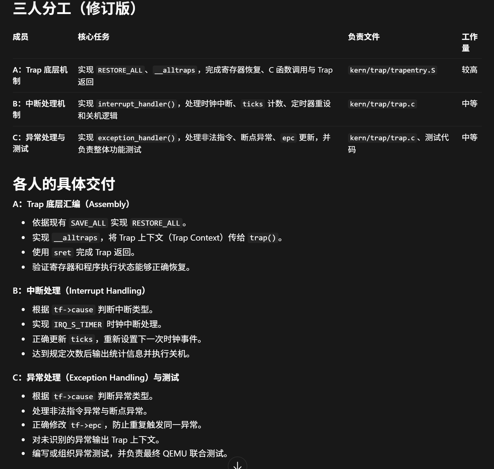

# Lab3 B 部分：作业讲解、代码修改与代码说明

---

## 1．用户

这是lab3的作业内容，请你查看代码和图片。我要做的是B部分，你先给我讲解一下我需要做什么



## 2．助手

结合图片和代码，**你负责 B：中断处理机制，核心是让内核持续接收时钟中断，完成计数、定期输出和自动关机。**

可以把定时器理解为一个“闹钟”：到达设定时间，CPU 暂停当前程序，执行你的处理函数；处理结束后，再继续原来的程序。

**1．你主要负责哪个函数**

主要文件是压缩包内的 `lab3/code/kern/trap/trap.c`，重点函数为：

```c
void interrupt_handler(struct trapframe *tf)
```

`tf` 保存了本次中断发生时的现场，包括中断原因、寄存器状态、返回地址等。你主要读取其中的 `tf->cause`，判断发生了什么中断。

整个流程是：

```text
时钟到点
   ↓
进入 Trap，保存现场                 ← A 负责
   ↓
trap() → trap_dispatch()
   ↓
interrupt_handler(tf)              ← 你负责
   ↓
恢复现场，返回原来的程序             ← A 负责
```

**2．你需要实现的四项核心逻辑**

**第一项：识别中断类型。**

`tf->cause` 同时包含“是否为中断”的标志和具体原因编号。处理时先去掉最高位的标志，再用 `switch` 分类。

你的重点分支是：

```c
case IRQ_S_TIMER:
```

它表示 **S 模式（监督者模式）的时钟中断**，也是这个实验中内核要响应的时钟中断。

**第二项：设置下一次时钟事件。**

每次处理时钟中断时，调用：

```c
clock_set_next_event();
```

这个函数在 `clock.c` 中，内部通过 `sbi_set_timer()`，把下一次触发时刻设置为“当前时间加上一个时间间隔”。

为什么每次都要调用？因为要形成下面这个连续过程：

```text
设置第一次事件 → 到点中断 → 设置下一次事件 → 再次中断 → ……
```

初始化负责第一次设置，你负责让后续中断持续发生。

**第三项：累计中断次数。**

每次进入时钟中断分支，执行：

```c
ticks++;
```

`ticks` 是 `clock.c` 中的全局变量，由时钟初始化函数清零，表示**累计发生了多少次时钟中断**。

注意两个区别：

- `ticks` 是中断次数，不直接等于秒数。
- 只有时钟中断才增加这个计数，其他中断不应增加。

**第四项：定期输出，达到阈值后关机。**

代码中两个配置分别控制打印间隔和关机条件：

```c
#define TICK_NUM 100
#define SHUTDOWN_AFTER 10
```

按这个配置：

| 条件 | 应执行的行为 |
|---|---|
| 每收到一次时钟中断 | `ticks` 加 1 |
| 每累计 100 次 | 调用 `print_ticks()` 输出一次 |
| 累计 10 组，即 1000 次 | 调用 `sbi_shutdown()` 关机 |

判断“是否累计到一组”，可以使用：

```c
ticks % TICK_NUM == 0
```

判断累计了多少组，可以使用：

```c
ticks / TICK_NUM
```

这里的 `print_ticks()` 输出固定文本 `100 ticks`，所以运行时应看到 10 行相同的 `100 ticks`。**图片没有明确规定具体次数，100 和 10 是代码中的配置，若老师另有数值要求，应按要求调整。**

**3．你的处理逻辑可以概括为**

```text
读取并识别中断原因
   ↓
如果是 S 模式时钟中断
   ├─ 设置下一次时钟事件
   ├─ ticks 加 1
   └─ 判断是否到达统计节点
          ├─ 到达：输出统计信息
          └─ 达到关机阈值：请求关机
```

此外，其他已定义中断可以输出相应提示；遇到未知中断，可以打印原因编号，并用 `print_trapframe(tf)` 输出现场，方便定位问题。

**4．你需要注意的分工和验证**

你与 C 都在 `trap.c` 中工作，需要协调各自的函数修改。C 负责 `exception_handler()` 中的非法指令和断点异常；你的重点是 `interrupt_handler()`。

**时钟中断处理应保持 `tf->epc` 不变。**它保存返回执行的位置，处理完时钟中断后，应继续被打断的执行流程。

验证时，你主要检查：

- 工程能够编译，内核启动后出现时钟初始化提示。
- 时钟中断能持续发生，`ticks` 持续增加。
- 按规定间隔输出统计信息。
- 达到规定次数后自动关机。
- 与 A 的现场恢复流程配合正常，中断返回后程序能够继续运行。

因此，你需要交付的内容主要是：**`interrupt_handler()` 的实现、时钟计数与关机的运行截图或日志，以及对上述处理流程的说明。**

---

## 3．用户

```csharp
[PROMPT]
任务：修改 lab3/code/kern/trap/trap.c，实现 B 部分
interrupt_handler()，完成中断分类、时钟计数、定时器重设、
统计输出和自动关机。
操作要求：直接修改实际文件，保留 A、C 已有代码。
输出要求：说明修改内容，提供编译和运行验证结果。

[RELY]
- struct trapframe：使用 cause 判断中断原因。
- libs/riscv.h：提供 IRQ_S_TIMER 等中断类型宏。
- ticks：已有全局时钟中断计数器。
- clock_set_next_event()：设置下一次时钟事件。
- print_ticks()：输出统计信息。
- print_trapframe()：输出未知中断现场。
- sbi_shutdown()：执行关机。
- 本次配置：TICK_NUM=100，SHUTDOWN_AFTER=10。

[GUARANTEE]
必须实现：
void interrupt_handler(struct trapframe *tf);

允许添加必要头文件和内部宏，不改变函数签名、
Trap 现场布局及已有异常处理逻辑。

[SPECIFICATION]
Pre-Condition：
tf 指向有效现场，时钟及相关接口已初始化。

Post-Condition：
正确处理中断，保持现场和返回地址不变；
正常处理后返回，达到阈值时关机。

Case 1：时钟中断
设置下一次事件，ticks 增加一次；每 100 次输出一次，
累计输出 10 次后关机。

Case 2：其他已知中断
输出对应类型提示，不修改时钟计数。

Case 3：未知中断
输出原因编号，并打印完整 Trap 现场。

Requirements：
正确排除 cause 最高位的中断标志，不修改 tf->epc。
通过编译、正常运行及原有评分验证，不修改测试条件。
```

## 4．助手

已修改实际文件 [trap.c](/C:/Users/HP/Documents/ChatGPT/OS2026/OSgroup/lab3/code/kern/trap/trap.c:87)，改动仅限 `interrupt_handler()`，A、C 代码和测试条件保持不变。

处理逻辑包括：

- 清除 `cause` 最高位标志后分类，保留原始现场和 `tf->epc`。
- 时钟中断每次计数一次，每 100 次打印一次，1000 次后关机。
- 在统计输出后重设定时器，避免串口打印消耗下一次间隔。
- 为已知中断输出提示，未知中断输出编号和完整现场。

验证结果：

| 检查 | 结果 |
|---|---|
| 编译 | 通过 |
| 正常运行 | 输出 10 行 `100 ticks` 后自动关机 |
| 原有评分 | **100/100** |

初轮评分出现 `ticks=201` 与预期文本不匹配；调整定时器重设顺序后，完整评分通过，未修改测试条件。

[验证记录与日志说明](/C:/Users/HP/Documents/ChatGPT/OS2026/lab3-b-verification/b-20261105/verification.md)

---

## 5．用户

讲解一下我负责部分的代码

## 6．助手

你负责的核心函数是 [trap.c 中的 `interrupt_handler()`](/C:/Users/HP/Documents/ChatGPT/OS2026/OSgroup/lab3/code/kern/trap/trap.c:87)。它接收中断现场，判断中断类型，然后执行对应处理。其中最重要的是 **S 模式时钟中断：计数、打印、安排下一次事件、达到阈值后关机。**

下面按代码的执行顺序讲。

**1．函数参数 `tf` 是什么**

```c
void interrupt_handler(struct trapframe *tf)
```

`tf` 是一个指针，指向保存中断现场的 `struct trapframe`。

你需要关注两个字段：

| 字段 | 含义 | 你的使用方式 |
|---|---|---|
| `tf->cause` | 为什么进入 Trap | 读取它，判断中断类型 |
| `tf->epc` | Trap 返回后继续执行的位置 | 保持不变 |

进入这个函数前，A 负责的汇编已经保存了寄存器等状态，并把现场地址传给 C 函数。

调用关系是：

```text
__alltraps
    ↓
trap(tf)
    ↓
trap_dispatch(tf)
    ↓
interrupt_handler(tf)
```

其中 `trap_dispatch()` 先区分“中断”和“异常”，再决定调用你的函数还是 C 负责的 `exception_handler()`。

**2．先从 `cause` 中提取中断原因编号**

```c
const uintptr_t interrupt_flag =
    (uintptr_t)1 << (sizeof(uintptr_t) * 8 - 1);

const uintptr_t cause = tf->cause & ~interrupt_flag;
```

`tf->cause` 不是一个单纯的编号，它的结构可以理解为：

```text
最高位：是否为中断
其余位：具体原因编号
```

以 RV64 的 S 模式时钟中断为例：

```text
原始值：0x8000000000000005
        ↑              ↑
     中断标志         原因编号 5
```

第一条语句构造一个“只有最高位是 1”的数：

```c
(uintptr_t)1 << (sizeof(uintptr_t) * 8 - 1)
```

逐步看：

- `uintptr_t` 是能容纳指针数值的无符号整数类型。
- RV64 中它通常占 8 字节，即 64 位。
- `sizeof(uintptr_t) * 8 - 1` 得到 `63`。
- 把 `1` 左移 63 位，就得到 `0x8000000000000000`。

先把 `1` 转为 `uintptr_t`，是为了让移位在正确的整数宽度上执行。

第二条语句：

```c
tf->cause & ~interrupt_flag
```

`~interrupt_flag` 的最高位是 0，其余位都是 1。按位与之后，**只清除最高位，保留原因编号**：

```text
0x8000000000000005
清除最高位
                  ↓
0x0000000000000005
```

结果放在局部变量 `cause` 中，**没有改写 `tf->cause`**，因此打印现场时还能看到原始原因值。`const` 表示这两个局部变量在初始化后不再被修改。

**3．用 `switch` 区分中断类型**

```c
switch (cause) {
    ...
}
```

提取原因编号之后，用 `riscv.h` 中的宏进行匹配。

例如：

```c
case IRQ_S_SOFT:
    cprintf("Supervisor software interrupt\n");
    break;
```

含义是：如果这是监督者软件中断，就输出对应提示，然后离开 `switch`。

代码中的主要类别包括：

| 宏的后缀 | 含义 |
|---|---|
| `SOFT` | 软件中断 |
| `TIMER` | 时钟中断 |
| `EXT` | 外部中断 |

此外，代码还为 `IRQ_COP` 和 `IRQ_HOST` 输出对应提示。

**这些提示分支没有执行 `ticks++`，因此其他类型的中断不会被算成时钟中断。**这些分支提供的是基本识别和提示，并没有实现完整的设备处理流程。

**4．核心：处理 `IRQ_S_TIMER`**

你的时钟分支是：

```c
case IRQ_S_TIMER:
    ticks++;

    if (ticks % TICK_NUM == 0) {
        print_ticks();
    }

    clock_set_next_event();

    if (ticks >= TICK_NUM * SHUTDOWN_AFTER) {
        sbi_shutdown();
    }
    break;
```

可以拆成四步理解。

**① 记录本次时钟中断**

```c
ticks++;
```

`ticks` 在 [clock.c](/C:/Users/HP/Documents/ChatGPT/OS2026/OSgroup/lab3/code/kern/driver/clock.c:7) 中定义：

```c
volatile size_t ticks;
```

它记录从时钟初始化开始，累计处理了多少次时钟中断。`clock_init()` 会把它初始化为 0。

这里的 `volatile` 告诉编译器：这个变量可能被当前正常执行流程之外的中断处理修改，读取时需要考虑其实际内存值。它本身不保证操作是原子的。

注意，**`ticks` 表示中断次数，不是秒数**；每次进入这个时钟分支只增加一次。

**② 每 100 次输出一次**

```c
if (ticks % TICK_NUM == 0) {
    print_ticks();
}
```

配置是：

```c
#define TICK_NUM 100
```

`%` 是取余运算。当 `ticks` 能被 100 整除时，条件成立：

```text
ticks = 99   → 余数 99 → 不打印
ticks = 100  → 余数 0  → 打印
ticks = 101  → 余数 1  → 不打印
ticks = 200  → 余数 0  → 打印
```

`print_ticks()` 中的普通输出语句是：

```c
cprintf("%d ticks\n", TICK_NUM);
```

它打印的是 `TICK_NUM`，所以每次都显示：

```text
100 ticks
```

这表示“又经过了 100 次中断”，而不是显示累计总数。打印后也没有清零 `ticks`，它仍然继续累计。

另外，`print_ticks()` 中的 `#ifdef DEBUG_GRADE` 是条件编译代码；只有定义这个宏时，才会额外执行测试结束提示和 `panic()`。

**③ 设置下一次时钟事件**

```c
clock_set_next_event();
```

它的实现是：

```c
void clock_set_next_event(void) {
    sbi_set_timer(get_cycles() + timebase);
}
```

虽然函数名叫 `get_cycles()`，这里实际使用的是 `rdtime` 指令，读取时间计数值。接着加上 `timebase`，通过 SBI 请求设置新的定时器截止时刻。

含义就是：

```text
下一次触发时刻 = 当前时间 + 一个间隔
```

初始化负责安排第一次事件；你的处理函数负责安排后续事件，从而形成：

```text
初始化设置事件 → 时钟中断 → 设置下一次事件 → 时钟中断 → ……
```

这里把重设操作放在统计输出之后，是为了让下一次间隔从输出结束后开始计算，避免串口打印较慢时，下一次事件在本次处理返回前就到期。

**④ 达到 1000 次后关机**

```c
if (ticks >= TICK_NUM * SHUTDOWN_AFTER) {
    sbi_shutdown();
}
```

两个配置是：

```c
#define TICK_NUM 100
#define SHUTDOWN_AFTER 10
```

因此阈值为：

```text
100 × 10 = 1000 次时钟中断
```

第 1000 次中断时，执行顺序是：

```text
ticks 增加到 1000
    ↓
打印第 10 行 “100 ticks”
    ↓
设置下一次时钟事件
    ↓
调用 sbi_shutdown() 请求关机
```

`sbi_shutdown()` 通过 SBI 向底层固件发出关机请求；在实验的 QEMU 环境中，表现为模拟器退出。

**5．未知中断怎么处理**

```c
default:
    cprintf("Unknown interrupt: cause %lu\n",
            (unsigned long)cause);
    print_trapframe(tf);
    break;
```

没有匹配到任何已知类型时，执行 `default`：

1. 打印去掉最高位标志后的原因编号。
2. 打印完整 Trap 现场，包含通用寄存器、状态、返回地址和原始原因值等信息。

这是为了帮助排查问题。**打印现场是诊断行为，并不意味着已经消除了未知中断的来源。**

**6．为什么你不修改 `tf->epc`**

时钟中断是计时事件，正常程序只是暂时被打断。处理结束后，应从保存的返回位置继续执行，因此你的函数不调整 `tf->epc`。

而 C 负责的非法指令、断点等异常，可能需要按实验策略跳过触发异常的指令，所以会调整 `epc`。

你的函数正常返回后，执行流会回到 A 的汇编返回路径，由它恢复现场并执行 `sret`。代码中的 `break` 只是离开 `switch`；**真正从 Trap 返回的操作是后面的 `sret`**。

