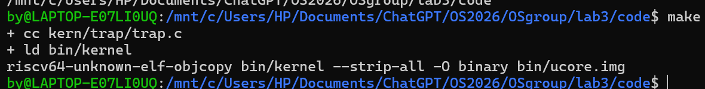
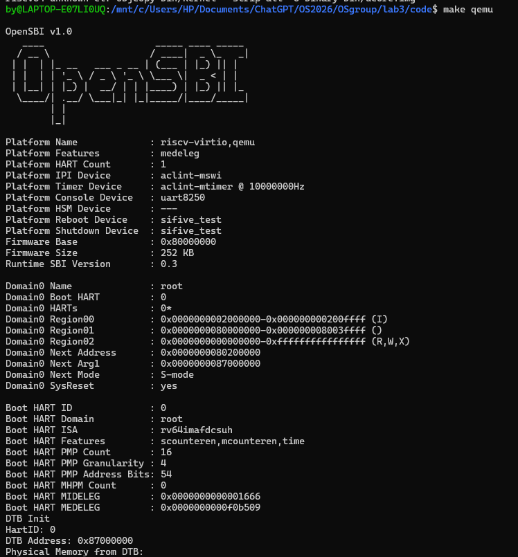
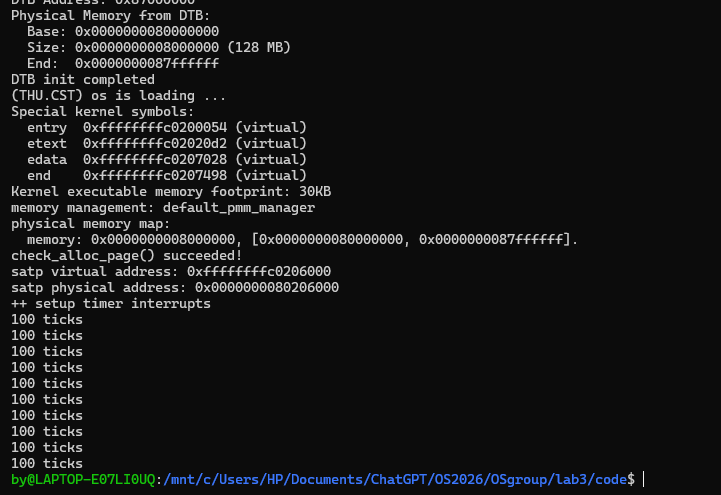
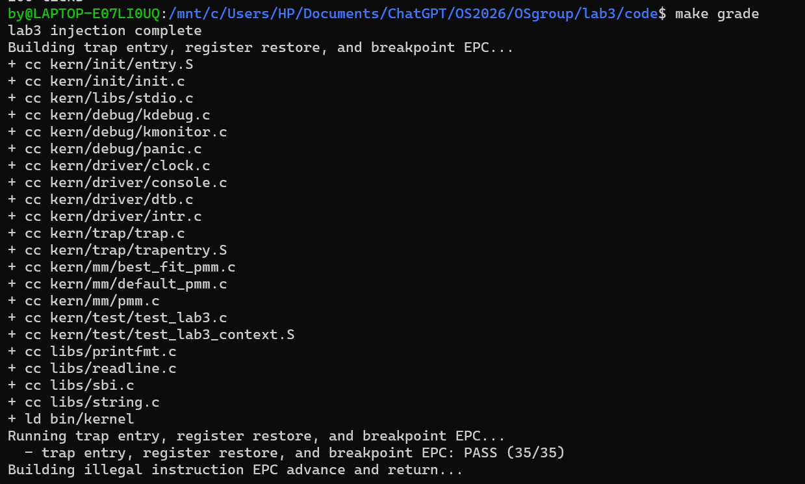
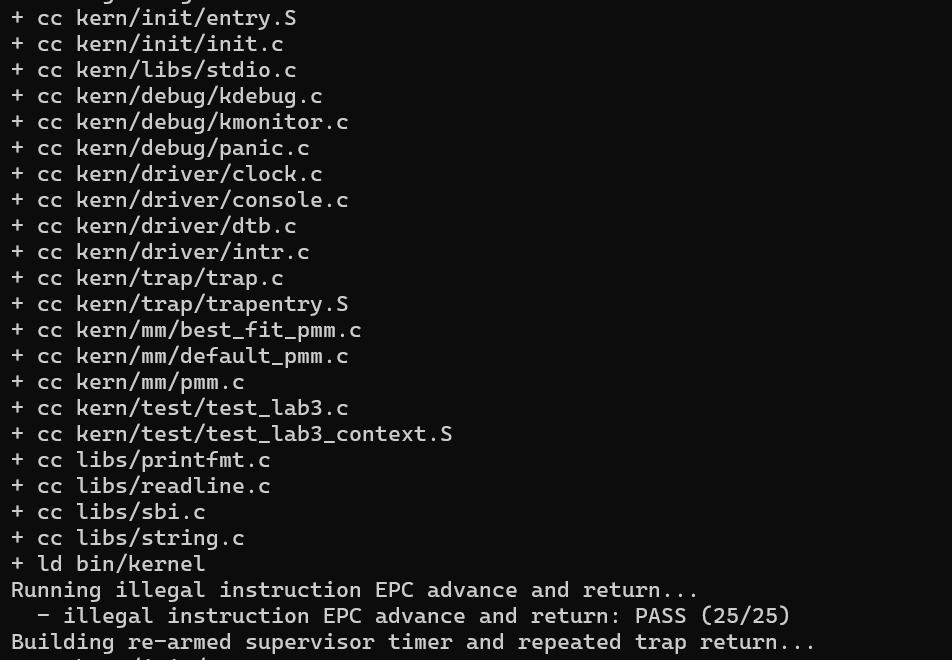
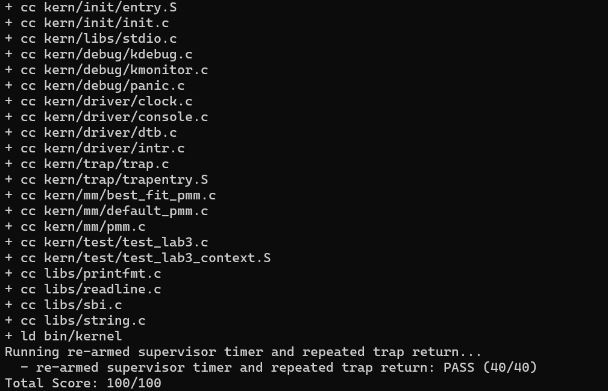

# 操作系统实验报告

## 实验基本信息

| 项目 | 内容 |
|------|------|
| **实验名称** | Lab 3：断，都可以断 |
| **小组成员** | 2412979-单馨淼 2413015-孙若晴 2411356-华轩宁|
| **完成日期** | 2026/11/04|


### 小组分工

| 成员 | 负责的练习/模块 |
|------|----------------|
| 2412979-单馨淼 | 模块一：Trap 上下文恢复与 Trap 入口 |
| 2411356-华轩宁 | 模块二中的异常处理与测试：exception_handler()、补充检查及与模块一的整合 |
| 2413015-孙若晴 | 模块二中的中断处理：interrupt_handler()、持续时钟计数、统计输出与关机及本机运行验证 |

---

## 一、实验目的

本实验围绕 RISC-V 的 Trap 处理机制展开，主要目标如下：

1. 理解中断与异常如何使处理器进入内核处理流程，掌握 `stvec`、`scause`、`sepc` 和 `sstatus` 在入口、原因识别及返回过程中的作用。
2. 根据已有的现场保存方式，实现 Trap 入口调用与现场恢复，理解 `struct trapframe` 的布局、参数传递和栈指针恢复顺序，使处理结束后能够返回原执行流。
3. 实现中断和异常的分类处理，完成非法指令、断点的信息输出及返回地址调整，并利用现场输出分析其他未专门处理的情况。
4. 实现持续时钟中断，在每次中断后设置下一次事件，完成时钟计数、周期性统计输出和达到规定次数后的关机流程。
5. 使用 AI 辅助梳理接口、编写实现和定位问题，通过编译、正常运行及课程测试检查各模块的配合，加深对现场保护、异常返回和时钟中断机制的理解。

---

## 二、实验环境

| 成员 | AI 编程工具 | 底层模型 | 备注 |
|------|------------|---------|------|
| 2412979-单馨淼 | Codex | GPT-6 | |
| 2411356-华轩宁 | Codex | GPT-6 | 使用 Codex 辅助完成异常处理代码 |
| 2413015-孙若晴| Codex |GPT6.1-Sol | 辅助分析中断处理、实现代码、定位启动问题及核对运行结果 |


---

## 三、实验整体逻辑分析

### 2.1 本章节的逻辑主线

本章的主线是建立“进入 Trap、保存现场、分类处理、恢复现场、返回执行”的完整流程，让内核能够响应时钟中断和指定异常。实验沿用 Lab2 的内存管理基础，再补齐入口汇编与 C 语言处理函数之间的衔接。

发生中断或异常后，CPU 将原因记录到 `scause`，将返回位置记录到 `sepc`，并跳转到 `stvec` 指向的 `__alltraps`。入口通过已有的 `SAVE_ALL` 将通用寄存器和相关控制寄存器保存到栈上的 `struct trapframe`，再把现场地址作为参数传给 `trap()`。`trap_dispatch()` 根据原因值的最高位，将中断交给 `interrupt_handler()`，将同步异常交给 `exception_handler()`。

两类处理在这一步分别展开：时钟中断处理设置下一次事件、增加计数，并在统计节点输出信息，达到规定次数后关机；非法指令和断点异常处理输出提示，并按指令长度调整现场中的 `epc`，使返回后跳过相应指令。其他未专门处理的异常通过 `print_trapframe()` 输出现场。

处理函数返回后，执行流进入 `__trapret`，由 `RESTORE_ALL` 恢复 `sstatus`、`sepc` 和通用寄存器，最后恢复 `sp`，再执行 `sret` 返回。这样，入口与恢复模块负责保存和还原执行状态，中断与异常处理模块负责具体响应，两部分共同形成完整的 Trap 处理流程。


### 2.2 功能的逐步实现

1. **准备基础环境**：沿用 Lab2 的内存初始化与页分配功能，为内核运行提供基础，使后续 Trap 处理能够在已有的内存环境中展开。
2. **完成 Trap 入口和现场恢复**：依据已有的 `SAVE_ALL` 实现 `RESTORE_ALL`，并在 `__alltraps` 中把现场地址传给 C 语言处理函数。处理结束后恢复寄存器，通过 `sret` 返回，建立完整的 Trap 进入与返回流程。
3. **实现中断与异常处理**：在入口能够正确传递现场的基础上，根据 `cause` 区分中断和异常，分别处理时钟中断、非法指令、断点及其他情况；需要跳过的异常指令还要按实际长度调整 `epc`。
4. **形成持续时钟中断流程**：初始化时钟，在每次时钟中断后设置下一次事件，完成计数、统计输出及达到规定次数后的关机行为，使单次中断处理连接成持续运行的流程。
5. **进行整体测试**：待各模块整合完成后，统一检查异常返回、寄存器恢复和持续时钟中断，再运行课程评分，确认入口、处理函数与返回流程之间的配合。

---

## 四、实验内容与实现

### 功能模块一：Trap 上下文恢复与 Trap 入口

**负责人：** 2412979-单馨淼

#### 模块功能描述

**需要实现/修改的函数：**

位于 `kern/trap/trapentry.S`，需要实现以下汇编功能：

- `RESTORE_ALL`：汇编宏，按现场布局恢复 `sstatus`、`sepc` 和通用寄存器，最后恢复栈指针 `sp`。
- `__alltraps`：Trap 入口，在保存现场后，将当前 Trap Frame 地址作为参数传给 `trap(struct trapframe *tf)`。

**功能说明：**

## 1. 本阶段内容

本阶段完成 `kern/trap/trapentry.S` 中的 Trap 底层汇编：

1. 根据 `SAVE_ALL` 实现 `RESTORE_ALL`。
2. 在 `__alltraps` 中把当前 Trap Frame 的地址作为参数传给 `trap()`。
3. 从 `trap()` 返回后恢复 Trap 上下文，并通过 `sret` 返回被中断的执行流。
4. 使用交叉编译、反汇编和 QEMU 上下文测试验证恢复结果。

## 2. 实现过程

### 2.1 Trap Frame 布局

`SAVE_ALL` 在栈上分配 `36 * REGBYTES` 字节。RV64 中 `REGBYTES` 为 8，因此一个 Trap Frame 占 288 字节。偏移 `0` 到 `31` 保存通用寄存器 `x0` 到 `x31`，偏移 `32` 到 `35` 依次保存 `sstatus`、`sepc`、`sbadaddr` 和 `scause`。

`x2` 是栈指针。进入 Trap 时，`SAVE_ALL` 先把原栈指针写入 `sscratch`，分配 Trap Frame 后再把原栈指针保存到偏移 `2 * REGBYTES`。因此恢复阶段不能先修改 `sp`，否则后续 `LOAD` 会失去 Trap Frame 的基址。

### 2.2 RESTORE_ALL

恢复顺序如下：

1. 从偏移 32 和 33 读取 `sstatus`、`sepc`，写回对应 CSR。
2. 恢复 `x1` 以及 `x3` 到 `x31`。
3. 最后从偏移 2 恢复 `x2/sp`。

`sbadaddr` 和 `scause` 描述本次 Trap 的原因，不参与返回状态恢复。`sret` 使用已经写回的 `sepc` 作为返回地址，并依据 `sstatus` 恢复 Trap 前的特权级与中断状态。

### 2.3 __alltraps

`SAVE_ALL` 执行后，`sp` 指向完整的 `struct trapframe`。RISC-V 调用约定使用 `a0` 传递第一个参数，因此入口代码执行：

```asm
move a0, sp
jal trap
```

这与 `void trap(struct trapframe *tf)` 的函数签名一致。`trap()` 返回后，执行流继续进入相邻的 `__trapret`，由 `RESTORE_ALL` 和 `sret` 完成返回。

#### 最终提示词

## 3. Spec 与 Prompt

### 3.1 Spec

本阶段的约束是：

- Trap Frame 布局必须与现有 `SAVE_ALL` 和 `struct trapframe` 完全一致。
- `RESTORE_ALL` 必须恢复 `sstatus`、`sepc` 和 Trap 前的通用寄存器值。
- `sp` 必须最后恢复。
- `__alltraps` 必须把 Trap Frame 指针作为 `trap()` 的第一个参数。
- 返回路径必须经过 `__trapret`，并以 `sret` 结束。
- 只填写 `lab3 function1` 标记处，不实现中断与异常处理模块，不实现 Challenge。

### 3.2 Prompt

> 分析现有 `SAVE_ALL`、`struct pushregs` 和 `struct trapframe` 的字段顺序，在 `lab3 function1` 标记处生成严格对称的 `RESTORE_ALL`；恢复 CSR 后按原偏移恢复通用寄存器，最后恢复 `sp`。在 `__alltraps` 中按照 RISC-V ABI 把当前 `sp` 作为 `trap()` 的第一个参数。不得修改函数签名，不得实现 function2 或 Challenge，并给出汇编和 QEMU 验证方法。

这个 Prompt 把数据布局、调用约定、改动范围和验证条件放在同一组约束中，生成结果可以直接与源码结构和反汇编结果核对。

#### 实现迭代过程

## 5. 实际问题与解决过程

### 5.1 Lab 3 依赖 Lab 2 已完成代码

starter code 中保留了 Lab 2 的物理内存管理占位内容，直接构建会在 `page_init()` 和页分配器处失败。实验目录以 Lab 3 starter code 为骨架，迁入仓库中已经完成的 Lab 2 页初始化和分配器实现，同时保留 Lab 3 新增的中断保护代码。

### 5.2 QEMU 启动参数不兼容

starter code 使用 `-device loader,file=bin/ucore.img,addr=0x80200000` 启动。本机的 QEMU 6.2 与 OpenSBI 0.9 在该参数下把下一跳地址设置为 `0x0`，内核没有开始执行。改用 `-kernel bin/ucore.img` 后，OpenSBI 把下一跳地址设置为 `0x80200000`，内核正常启动。

### 5.3 断点指令长度

首次临时测试把 `sepc` 增加 4，返回后测试报告寄存器上下文失败。反汇编显示工具链把 `ebreak` 编码为 2 字节的压缩指令 `0x9002`。测试桩将 `sepc` 增加 2 后，程序从紧随断点的第一条校验指令继续执行，测试通过。


---

### 功能模块二：异常处理与测试

### 函数一
**负责人：** 2413015-孙若晴

#### 模块功能描述

**需要实现/修改的函数：**

```c
void interrupt_handler(struct trapframe *tf);
```

函数位于 `kern/trap/trap.c`，对应 `lab3 function2` 标记。另补充 `#include <sbi.h>` 和 `SHUTDOWN_AFTER` 宏，复用现有时钟与打印接口。

**功能说明：**

| 中断类型 | 处理行为 |
| --- | --- |
| `IRQ_S_TIMER` | 设置下一次时钟事件，更新 `ticks`，定期输出统计并在达到阈值后关机 |
| 其他已定义的软件、时钟和外部中断 | 输出对应类型的基本提示 |
| 未识别的中断 | 输出原因编号，并调用 `print_trapframe(tf)` 输出原始现场 |

现有 `trap_dispatch()` 已用 `cause` 的最高位区分中断和异常。处理函数先排除最高位标志，得到用于分类的原因编号，但不改写 `tf->cause`：

```c
uintptr_t cause = tf->cause & ~((uintptr_t)1 << (sizeof(uintptr_t) * 8 - 1));
```

本实验中，S 模式时钟中断的原始原因值为 `0x8000000000000005`，去除最高位后得到 `5`，对应 `IRQ_S_TIMER`。对于原测试直接传入的不带标志的原因编号，也能保持其原值进行分类。

时钟分支的核心实现如下：

```c
case IRQ_S_TIMER:
    clock_set_next_event();
    ticks++;
    if (ticks % TICK_NUM == 0) {
        print_ticks();
        if (ticks / TICK_NUM >= SHUTDOWN_AFTER) {
            sbi_shutdown();
        }
    }
    break;
```

`clock_set_next_event()` 安排下次事件，使时钟中断能够持续发生；`ticks` 使用 `clock.c` 中已有的全局变量，每次中断恰好增加一次，不在输出后清零。`ticks % TICK_NUM == 0` 表示到达统计节点，`ticks / TICK_NUM` 表示累计统计输出次数。

当前配置为 `TICK_NUM = 100`、`SHUTDOWN_AFTER = 10`，因此每 100 次中断输出一行 `100 ticks`，累计输出 10 行、对应 1000 次中断后请求关机。每行描述一个统计区间，不会依次打印为 `200 ticks`、`300 ticks`。指导书未给出关机宏的具体数值，10 是本次采用并验证的配置。

其他已知类型输出对应提示；未知类型输出 `Unknown interrupt: cause ...` 和完整现场。中断分支不修改 `tf->epc`，正常处理后由已有汇编恢复现场并返回。

#### 最终提示词

以下使用按本次任务整理的简短四段式版本：

```text
[PROMPT]
任务：修改 lab3/code/kern/trap/trap.c，实现 B 部分
interrupt_handler()，完成中断分类、时钟计数、定时器重设、
统计输出和自动关机。
操作要求：直接修改实际文件，保留 A、C 已有代码。
输出要求：说明修改内容，提供编译和运行验证结果。

[RELY]
- struct trapframe：使用 cause 判断中断原因。
- libs/riscv.h：提供 IRQ_S_TIMER 等中断类型宏。
- ticks：已有全局时钟中断计数器。
- clock_set_next_event()：设置下一次时钟事件。
- print_ticks()：输出统计信息。
- print_trapframe()：输出未知中断现场。
- sbi_shutdown()：执行关机。
- 本次配置：TICK_NUM=100，SHUTDOWN_AFTER=10。

[GUARANTEE]
必须实现：
void interrupt_handler(struct trapframe *tf);

允许添加必要头文件和内部宏，不改变函数签名、
Trap 现场布局及已有异常处理逻辑。

[SPECIFICATION]
Pre-Condition：
tf 指向有效现场，时钟及相关接口已初始化。

Post-Condition：
正确处理中断，保持现场和返回地址不变；
正常处理后返回，达到阈值时关机。

Case 1：时钟中断
设置下一次事件，ticks 增加一次；每 100 次输出一次，
累计输出 10 次后关机。

Case 2：其他已知中断
输出对应类型提示，不修改时钟计数。

Case 3：未知中断
输出原因编号，并打印完整 Trap 现场。

Requirements：
正确排除 cause 最高位的中断标志，不修改 tf->epc。
通过编译、正常运行及原有评分验证，不修改测试条件。
```

#### 实现迭代过程

1. **核对接口并补全 B 函数。** 初始工程中 `interrupt_handler()` 只有声明，A 的 Trap 入口与 C 的异常处理已有实现。在 AI 辅助下核对原因宏、计数器和关机接口，补齐中断分支与关机配置，交叉编译通过。
2. **定位启动分页问题。** 初次运行只看到 OpenSBI 信息，尚未进入内核日志。AI 辅助 GDB 跟踪发现，开启分页后仍在物理入口附近执行，而启动页表仅保留高地址内核映射。补上根页表第 2 项的恒等映射，使入口指令在跳转高地址前仍可继续执行；原有第 511 项高地址映射保留。
3. **修正启动与脚本兼容问题。** 将 `Makefile` 的 qemu/debug/test 及 `tools/grade.sh` 中的旧 loader 参数调整为 `-kernel`，并让评分 shell 脚本使用 LF 换行。以上为联调所需的辅助修改，没有调整 A 的 `trapentry.S`、C 的 `exception_handler()` 或评分断言。
4. **完成运行验证。** AI 辅助验证时，Windows 挂载目录中的评分副本曾出现日志截断及 `ticks=201` 不满足精确匹配的问题；相同源码和原测试转到 WSL Linux 临时目录后得到 100/100。随后本人依次执行 `make`、`make qemu` 和 `make grade`，正常运行及三项评分均通过，截图见第五节。

本次修改文件为 `kern/trap/trap.c`、`kern/init/entry.S`、`Makefile` 和 `tools/grade.sh`，其中 B 的正式功能在 `trap.c`，其余为上述联调修复。

---

### 函数二

**负责人：** 2411356-华轩宁

#### 模块功能描述

**需要实现/修改的函数：**

```c
void exception_handler(struct trapframe *tf);
```

该函数位于 `kern/trap/trap.c`。同时在 `kern/trap/trap.h` 增加公开声明。

**功能说明：**

输入是已有 Trap 入口保存的有效现场。函数通过 `tf->cause` 识别异常类型，输出要求的信息，必要时调整 `tf->epc`，然后交回原有 Trap 返回流程。

| 异常类型 | 本次处理 | 返回位置调整及依据 |
|----------|----------|--------------------|
| `CAUSE_ILLEGAL_INSTRUCTION` | 输出 `Illegal instruction at ...` | 课程测试使用 `.word 0x0000007b`，长度为 4 字节，因此 `epc += 4` |
| `CAUSE_BREAKPOINT` | 输出 `Breakpoint at ...` | 读取故障指令的首个 16 位半字；最低两位为 `11` 时跳过 4 字节，否则跳过 2 字节，覆盖本实验的 ebreak 与 c.ebreak |
| 其他异常 | 调用已有 `print_trapframe(tf)` | 保持 epc 不变 |

课程源代码中的 `ebreak` 可能被工具链编码成 2 字节的 `c.ebreak`（`0x9002`）；普通 `ebreak` 的编码是 `0x00100073`，占 4 字节。

实现代码如下：

```c
void exception_handler(struct trapframe *tf) {
    switch (tf->cause) {
        case CAUSE_ILLEGAL_INSTRUCTION:
            cprintf("Illegal instruction at 0x%016lx\n", tf->epc);
            /* Lab3 tests use .word 0x0000007b, a 32-bit custom opcode.
             * This is the lab's skip policy, not general illegal-op recovery. */
            tf->epc += 4;
            break;
        case CAUSE_BREAKPOINT:
            cprintf("Breakpoint at 0x%016lx\n", tf->epc);
            /* ebreak = 0x00100073; c.ebreak = 0x9002. Read only the
             * first halfword so a compressed breakpoint needs no next page. */
            tf->epc += (*(const uint16_t *)tf->epc & 3) == 3 ? 4 : 2;
            break;
        default:
            print_trapframe(tf);
            break;
    }
}
```

#### 最终提示词


````markdown
[PROMPT]
请完成 uCore RISC-V Lab3 的“异常处理与测试”任务，实际修改工程文件。

工程目录：E:\os-labs\lab3\lab3_new
实验指导书：E:\os-labs\lab3\lab3流程.pdf

在 kern/trap/trap.c 中实现 exception_handler()，处理非法指令、
断点及其他异常。

先阅读指导书、实际代码和原有测试，确认当前实现状态，再补充缺失功能。
已有的正确代码保留。
今年无需完成旧版 Challenge，包括用户态与内核态切换测试。

[RELY]
结合以下现有定义、接口和测试实现：
1. kern/trap/trap.c 中的 trap_dispatch()、trap()、print_trapframe() 及已有处理逻辑。
2. kern/trap/trap.h 中的 struct trapframe，特别是 cause、epc 和寄存器现场字段。
3. libs/riscv.h 中的异常原因常量和相关定义。
4. kern/trap/trapentry.S 中的 SAVE_ALL、RESTORE_ALL、__alltraps 和 __trapret，理解现场传递与返回流程。
5. tools/test_lab3.c、tools/test_lab3_context.S、tools/test_lab3.h、tools/grade.sh、tools/inject.py 和 Makefile，核对测试注入方式、期望输出、指令长度和运行命令。

整体测试时，按需检查时钟初始化、中断处理和内存初始化是否具备。
以指导书、实际代码和原有测试为依据。

[GUARANTEE]
实现并保持以下接口：
void exception_handler(struct trapframe *tf);

输入为已有 Trap 入口保存并传入的有效现场。
函数根据 tf->cause 识别异常，完成规定的信息输出和必要的
tf->epc 更新，再交回已有 Trap 返回流程。

完成后应保证：
1. 正确识别并处理非法指令和断点异常。
2. 对本实验要求跳过的异常指令，正确更新返回位置，避免反复执行同一条异常指令。
3. 对其他未要求专门处理的异常，调用已有的print_trapframe(tf) 输出现场。
4. 保持 struct trapframe 布局、公开接口和已有分发、入口、恢复、中断处理逻辑不被擅自改动。
5. 测试与正常运行流程分开，默认启动不自动执行补充异常测试。

[SPECIFICATION]
Pre-Condition：
检查当前工程、已有修改和依赖功能的完成状态。

Case 1：非法指令异常
识别 CAUSE_ILLEGAL_INSTRUCTION。
按指导书和原有测试要求输出异常信息。
根据本实验实际使用的指令编码及长度更新 tf->epc，说明判断依据。
验证处理后能执行异常指令之后的代码。

Case 2：断点异常
识别 CAUSE_BREAKPOINT。
按规定输出断点信息。
核对测试实际使用的断点指令长度，正确更新 tf->epc。
验证异常处理后继续执行，并结合原有测试检查寄存器恢复。

Case 3：其他异常
调用 print_trapframe(tf) 输出现场。
不无条件增加 epc，不自行扩展处理功能。

Case 4：修改范围与依赖
正式功能修改以 exception_handler() 为主，必要时增加最少的头文件或辅助函数，并说明原因。
如依赖尚未完成，说明具体缺失及影响，继续完成可独立进行的工作。

Case 5：测试与整体验证
优先阅读并使用课程原有测试。
依赖齐备后执行编译、make qemu 和 make grade。
检查断点与非法指令处理后能否继续执行、寄存器恢复是否正确，以及其他异常的现场输出。
整体测试同时核对持续时钟中断和原评分要求，发现其他模块问题时提供复现步骤及定位依据。
对原有测试未覆盖的关键异常行为，按需增加最小补充测试。
区分直接调用 exception_handler() 的检查与真实触发异常的QEMU 测试。

Case 6：验证记录与现场演示
在 E:\os-labs\lab3\verification\c-exception 下保存必要的测试说明、实际命令、原始日志和结果汇总。
明确区分通过、失败、未运行和因依赖缺失而无法执行的项目。
如使用隔离副本或环境适配，说明差异并分别记录结果。
准备解释异常入口、cause 与 epc 的含义、更新 epc 的原因和长度依据，以及如何证明异常处理后继续执行。

Post-Condition：
交付异常处理实现、必要的补充测试、验证记录和现场演示说明。

最后说明：
1. 修改了哪些文件以及修改原因；
2. 实现对应指导书的哪些内容；
3. 各类异常的处理方式和返回位置更新依据；
4. 实际执行的检查、结果及覆盖范围；
5. 尚未验证的内容和下一步。
````


#### 实现迭代过程

实现过程如下。

##### 核对框架并实现异常处理

最初的独立 Lab3 工程中，`exception_handler()` 还没有实现，入口恢复、中断处理和部分内存依赖也不完整。因此先依据已有的 `struct trapframe`、原因常量和测试用例完成可以独立实现的异常分支。

实现前核对了非法指令测试的 `.word 0x0000007b`，以及课程上下文测试中 `ebreak` 的实际编码。断点处理根据编码区分 2 字节和 4 字节。

**最终结果：** 完成异常处理实现。

---


## 五、测试与验证

## 4. 验证

### 4.1 汇编与反汇编

使用 `riscv64-unknown-elf-gcc` 单独编译 `trapentry.S`。反汇编结果显示：

- 入口执行 `addi sp, sp, -288`，与 36 个 64 位字段一致。
- 调用前执行 `mv a0, sp` 和 `jal trap`。
- 返回路径写回 `sstatus` 和 `sepc`。
- `sp` 在其他通用寄存器之后恢复。
- 最后一条指令为 `sret`。

### 4.2 QEMU 上下文测试

在临时验证副本中加入仅用于返回断点的异常处理桩，运行 starter code 自带的 `test_lab3_register_context`。测试在 Trap 前为 `t0-t2`、`s0-s11`、`a1-a7` 和 `t3-t6` 写入不同值，执行 `ebreak`，返回后逐一比较。

最终输出为：

```text
Breakpoint at 0xc0201a28
[Test 1] Trap entry and breakpoint return: PASS (35/35)
```

该结果说明 Trap 处理函数调用没有破坏被测试的寄存器值，`sepc` 调整后程序也从断点后的正确位置继续执行。

---

### 个人编译、时钟运行与整体评分（孙若晴）

在 WSL Ubuntu 终端进入工程后，依次执行：

```bash
cd /mnt/c/Users/HP/Documents/ChatGPT/OS2026/OSgroup/lab3/code
make
make qemu
make grade
```

**编译结果：** `make` 编译 `kern/trap/trap.c` 并链接内核，生成 `bin/kernel` 与 `bin/ucore.img`，没有报错。



图 B-1：本人执行 `make` 的输出。

**正常运行结果：** QEMU 经 OpenSBI 进入内核，完成内存初始化并输出 `++ setup timer interrupts`，随后输出 10 行 `100 ticks`，最后自动退出并返回终端提示符。该结果验证了当前配置下的持续时钟中断、统计输出和累计 1000 次中断后的关机流程。



图 B-2：本人执行 `make qemu`，固件显示 OpenSBI v1.0，下一跳地址为 `0x80200000`。



图 B-3：时钟初始化、10 行 `100 ticks` 及返回终端提示符。

**课程原有评分结果：** `make grade` 在临时副本中注入测试，三项均通过，总分 100/100；未修改测试的断言、期望值或超时时限。

| 测试项目 | 本人实际运行结果 | 覆盖范围 |
| --- | --- | --- |
| Trap 入口、寄存器恢复与断点返回地址 | PASS，35/35 | A、C 与整体 Trap 返回流程 |
| 非法指令返回及处理函数兜底 | PASS，25/25 | C 的异常处理，以及 B 的软件、未知中断分支 |
| 持续 S 模式时钟中断与反复返回 | PASS，40/40 | B 的计数、事件重设及与返回流程的配合 |
| 合计 | **100/100** | 当前原有三项测试全部通过 |



图 B-4：第一项评分 PASS，35/35。



图 B-5：第二项评分 PASS，25/25。



图 B-6：第三项评分 PASS，40/40；最终 `Total Score: 100/100`。

上述评分是 A、B、C 整合后的结果，不能全部归为 B 独立实现。正常运行截图补充证明了评分项之外的 10 次输出与关机条件；其他级别中断分支尚未逐项以真实硬件中断触发验证。

---

## 六、实验总结与收获

### 对操作系统的理解

## 6. 知识点

Trap 上下文保存对应操作系统原理中的中断现场保护。原理课描述的是保存处理器状态、执行处理程序、恢复状态三个阶段；本实验把这三个阶段落实为栈上的 `struct trapframe`、C 函数 `trap()` 和汇编返回路径。

Trap Frame 与普通函数栈帧的区别在于保存范围。普通函数按照 ABI 只保存调用约定要求的寄存器；Trap 可以发生在任意指令之间，因此入口必须保存可能被处理过程改写的处理器状态。

`sret` 不只是一次普通跳转。它读取 `sepc` 决定返回地址，并根据 `sstatus.SPP`、`sstatus.SPIE` 更新特权级和中断使能状态。由此，CSR 恢复和通用寄存器恢复共同构成完整的 Trap 返回。

RISC-V 的 Trap 委托机制决定某类中断或异常最终进入 M 模式还是 S 模式。本实验直接处理的是已经委托到 S 模式的 Trap；委托关系由 OpenSBI 和相关 CSR 建立，不体现在 `RESTORE_ALL` 的指令序列中。


### 异常处理部分的理解与收获

| 实验中的内容 | 对应 OS 原理 | 本次理解 |
|--------------|-------------|----------|
| cause 区分异常原因 | 中断与异常的分类处理 | 处理函数根据异常原因选择对应行为，中断由 trap_dispatch 分发给 interrupt_handler |
| epc 保存并更新故障位置 | 异常返回与恢复执行流 | 本实验的非法指令和断点属于同步异常，保存位置指向故障指令；实验选择跳过时，必须按实际长度更新返回位置 |
| 使用已有 trapframe | 现场保护和恢复 | C 函数调整现场中的返回地址，入口汇编恢复寄存器并执行 sret，二者共同完成异常返回 |
| 未知异常打印现场 | 异常诊断与恢复策略 | 通过现场输出定位异常，保留故障位置供后续分析 |

OS 原理中还有本部分没有实现的内容：进程调度与时间片切换、缺页后的页面调入、系统调用参数检查和完整用户态保护。

### 中断处理部分的理解与收获

1. `cause` 同时包含中断标志和原因编号，分类时应分离两者，并保留原始现场供调试。
2. 持续计时由初始化设置首个事件，再由每次处理设置后续事件形成；计数与事件重设必须配合。
3. 中断返回需要继续被打断的执行流，因此 B 保持 `epc` 不变；异常指令跳过由异常处理模块完成。
4. 普通运行和评分覆盖不同条件：10 行输出与自动退出验证关机流程，原测试还检查异常返回、寄存器恢复和持续中断。进程调度与时间片切换不在本次实现范围内。

### AI 协作开发的经验

以下经验来自异常处理的实现过程。

1. 提示词需要把实际接口和原有测试一起交给 AI。仅写“处理断点”容易忽略压缩指令，明确要求核对编码与长度后，才能让返回地址的修改有依据。

2.在 AI 辅助下，先用四段式提示词明确接口、依赖和行为，再核对实际代码并补全函数。联调时区分启动、运行和评分阶段，用 GDB、日志和原测试定位问题；本人亲自运行命令并保存截图核对结果。提示词明确要求保持其他成员逻辑和测试条件，避免把评分通过等同于所有中断类型都已充分验证。

---
